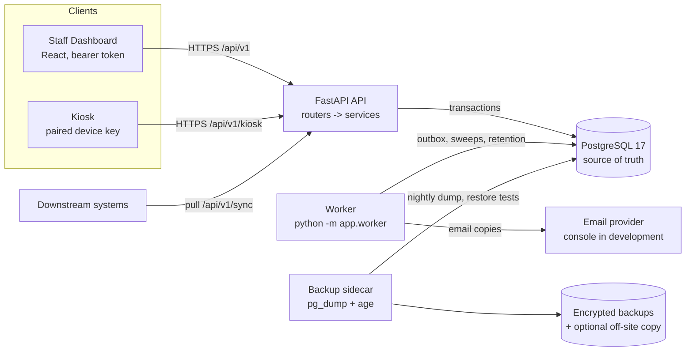
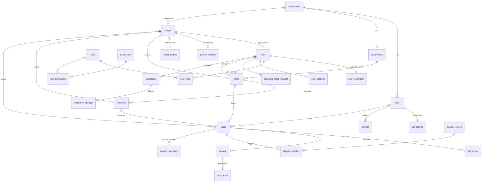
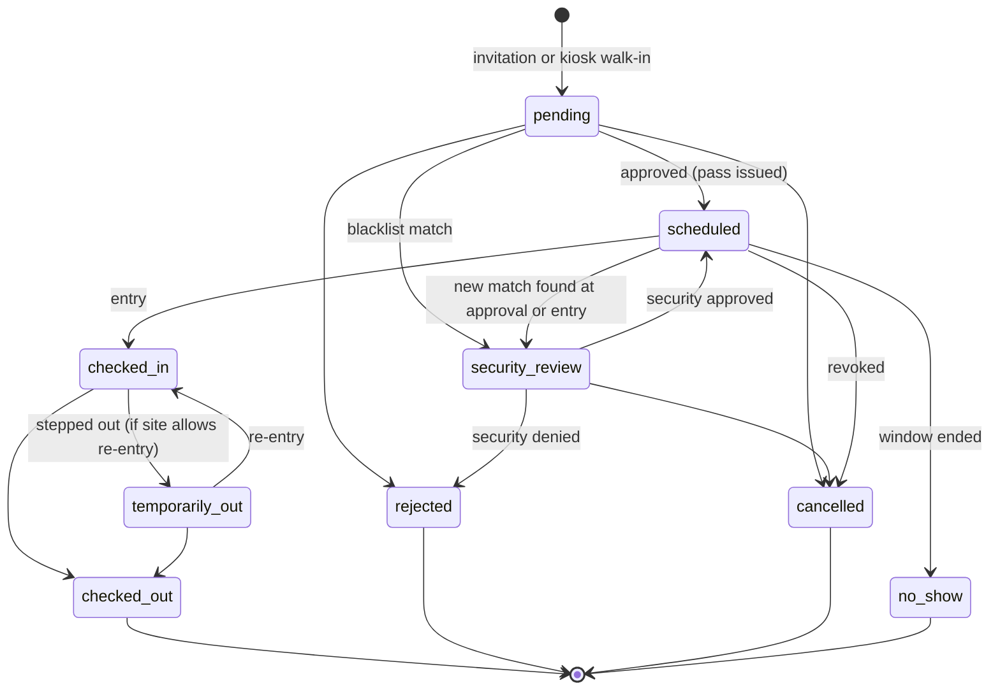

# VisitorHub backend

This is the reference for how the backend works: its structure, the data model, and the rules the code and database enforce. Companion documents:

| Document | Contents |
|---|---|
| [SCHEMA.md](SCHEMA.md) | Every table, column, key, delete rule, constraint, index and trigger. It is generated from the database, so it always matches the migrations. |
| [OPERATIONS.md](OPERATIONS.md) | Configuration, the worker, backups and restores, monitoring, key rotation, and emergency recovery. |
| [DATABASE_DESIGN.md](DATABASE_DESIGN.md) | Design record: the original findings, the decisions taken, and the implementation report for each phase. |

---

## 1. Architecture



- **PostgreSQL is the only source of truth.** There is no cache that can make an entry decision. Pass validity, revocation and blacklist state are always read from the primary database inside the same transaction that admits a visitor.
- **Every write goes through the API.** The browsers never touch the database. Each endpoint validates input, enforces permissions and organization/site scope, and changes related rows in one transaction. It then returns the saved record, which is the authoritative state.
- **Side effects run after commit.** Email copies and the sync feed come from the transactional outbox, so a delivery failure can never undo a check-in.

### Code layout

```
Backend/
  app/
    main.py             app setup, middleware (request id + client IP for audit, kiosk flood guard), router registration
    config.py           settings from environment variables (see OPERATIONS.md)
    database.py         engine and session factory
    models.py           SQLAlchemy models (one class per table)
    schemas.py          Pydantic request/response models
    security.py         password hashing, token hashing, sessions, Principal (role + site scope), device authentication
    routers/            HTTP layer: one module per area; thin, delegates to services
      common.py         shared helpers: scoping, optimistic locking, response shaping, audit shortcut
      auth.py organizations.py users.py hosts.py visits.py kiosk.py devices.py security.py retention.py activity.py ops.py sync.py
    services/           business rules, each usable from routers, jobs and tests
      accounts.py       account creation, roles, sign-in/lockout, password change and recovery
      identity.py       visitor matching, merging, visitor profile updates
      visits.py         visit state machine, passes, check-in/out, re-entry, overdue/no-show sweeps
      screening.py      blacklist matching and security decisions
      devices.py        kiosk registration and pairing
      audit.py          the only writer of audit_logs
      notify.py         notifications (in-app + queued email) and the email delivery handler
      outbox.py         transactional outbox and its processor
      retention.py      retention policies, anonymization and age-based deletion
      idempotency.py    Idempotency-Key handling for create endpoints
    jobs.py worker.py   scheduled jobs and the worker loop
    bootstrap.py recovery.py restore_reconcile.py   operator commands
  migrations/versions/  Alembic migrations 0001-0008
  backup/               backup sidecar image and scripts
  scripts/              demo setup, provisioning, schema doc generator
  tests/                pytest suites (run against a disposable PostgreSQL)
```

---

## 2. Data model

38 tables in seven groups. This diagram shows the core relationships; [SCHEMA.md](SCHEMA.md) has every foreign key.



### Conventions (applied everywhere)

| Convention | Rule |
|---|---|
| Identifiers | UUID primary keys, generated by the application or `gen_random_uuid()`. Append-only logs (`authentication_events`, `pass_scans`, `notification_attempts`, `outbox_events`) use identity bigints because order matters. |
| Time | `timestamptz` everywhere, stored in UTC. `sites.timezone` (an IANA name) is for display only. "Today" in the dashboard summary is the UTC day. |
| Tenant isolation | Child tables reference parents through **composite foreign keys** `(organization_id, x_id) → parent(organization_id, id)`. The database rejects any row that links records from two organizations, even if application code tried to. |
| Deleting | History is never cascaded away. Business records use `ON DELETE RESTRICT` and are deactivated with a `status` column; only pure child rows cascade (e.g. `role_permissions`, `site_settings`, `notification_attempts`). |
| States | Status columns are `TEXT` + `CHECK (status IN (...))`, not Postgres enums, so new states need no type migration. `is_active` columns on `organizations`, `sites`, `users` and `hosts` are **generated** from `status`/`account_status`. |
| Concurrency | Mutable records carry `version` (SQLAlchemy `version_id_col`): every update is `WHERE id = ? AND version = ?`, and a lost race returns **409**. PATCH bodies may include the `version` the client read to detect edits made in between. State changes on a visit additionally take a row lock (`SELECT … FOR UPDATE`). |
| `updated_at` | Maintained by the `set_updated_at()` trigger, so raw SQL updates are covered too. |
| Append-only history | `audit_logs`, `visit_events`, `authentication_events` and `pass_scans` reject `UPDATE`/`DELETE` through the `reject_history_change()` trigger. Only a transaction that sets `vms.allow_history_changes = on` can change them, and only the retention job does that. |
| Secrets | Passwords: Argon2id (`pwdlib`), with a CHECK that the stored value is an Argon2id hash. Reset links and device keys: HMAC-SHA-256 with `TOKEN_PEPPER`. QR pass tokens: SHA-256 for lookup (256-bit random, so brute force is infeasible) plus a Fernet-encrypted copy under `PASS_ENCRYPTION_KEY` while the pass is active. None of these values is ever written to logs, audit rows, events or the outbox. |

---

## 3. Roles, permissions and scope

### Roles

| Role | Scope (`roles.scope`) | Typical user |
|---|---|---|
| `super-admin` | platform: no site; sees every organization | Platform operator |
| `site-admin` | organization_or_site: **no site = organization-wide administrator**; one or more sites = limited to those sites | Organization / site administrator |
| `receptionist` | site: one or more sites required (enforced by trigger) | Front desk / security staff |
| `host` | site: one or more sites required | Employee receiving visitors |

An account holds role assignments in `user_roles`, one row per site. If an account has several roles, the highest-priority one is effective. Its site scope is the set of sites assigned to that role, or *unrestricted* if any assignment has no site.

### Permissions (seeded in migrations 0004, 0006, 0007, 0008)

| Permission | Super Admin | Site Admin | Receptionist | Host |
|---|:-:|:-:|:-:|:-:|
| `organization.manage` (organizations, ops health, sync feed, retention preview) | ✓ | | | |
| `site.manage`, `user.read`, `user.manage`, `user.reset_password`, `host.manage` | ✓ | ✓ | | |
| `device.manage`, `blacklist.manage`, `security.approve`, `retention.hold`, `visitor.merge`, `visitor.deactivate`, `visit.reject` | ✓ | ✓ | | |
| `visit.check_in`, `walk_in.register`, `visitor.update` | ✓ | ✓ | ✓ | |
| `visit.create`, `visit.update`, `visit.approve`, `pass.revoke` | ✓ | ✓ | | ✓ |
| `visit.read`, `host.read`, `audit.read` | ✓ | ✓ | ✓ | ✓ |

### Scoping rules (applied on top of permissions)

- Non-super-admins only see rows of **their organization**, and only at **their sites** when their role is site-limited. A multi-site account is never widened to the whole organization.
- **Hosts** see only visits for host entries linked to their own account (`hosts.user_id`). They can approve walk-ins for themselves, but never their own invitations.
- **Site Admins** can create and manage only host and receptionist accounts, at their own sites, and cannot change anyone's scope beyond their own.
- A record outside the caller's scope returns **404, not 403**, so its existence is not revealed. A missing permission returns 403.
- Super Admins are platform-wide for organizations, sites and users. Some list endpoints (hosts, departments) still show the Super Admin's own organization by default.

---

## 4. Authentication and passwords

| Topic | Rule |
|---|---|
| Sign-in | `POST /auth/login` with email + password. Unknown email and wrong password give the same 401 and take the same time (a dummy Argon2 verification runs for unknown emails). |
| Lockout | 5 consecutive failures lock the account for 15 minutes. The correct password is refused during the lockout with the same message. More than 50 failures from one IP in 15 minutes returns 429. All of these are configurable. |
| Sessions | Each sign-in creates a `user_sessions` row. The JWT (HS256, `JWT_SECRET`) carries the session id, and every request checks that the session is neither revoked nor expired (30 minutes by default). Logout, deactivation, a password change or a reset revoke sessions immediately. |
| Hash upgrades | When the Argon2 parameters change, a hash is upgraded transparently at the next successful sign-in. |
| Change password | `POST /auth/password` requires the current password. It keeps the current session and signs out all others. |
| Self-service reset | `POST /auth/password-reset` always answers 202 with the same body. If the account exists and is active, a 32-byte single-use link is emailed (`DASHBOARD_URL/reset-password#token=…`; the token travels in the URL fragment, so it never reaches server logs). Only an HMAC of the token is stored. Links last **30 minutes** (15 for administrators); a new request cancels the previous link. Requests are rate-limited to one per 60 seconds per user, 5 per hour per user and 20 per hour per IP. |
| Completing a reset | `POST /auth/password-reset/complete` consumes the token with a single atomic `UPDATE … WHERE consumed_at IS NULL AND expires_at > now() RETURNING`, so it can only be used once even under concurrency. It then replaces the hash, clears any lockout, revokes all sessions, marks the email as verified, records an authentication event and an audit row, and emails a security notice. |
| Administrators | A reset of a Super Admin or Site Admin also notifies every other administrator in the organization, in-app and by email. |
| Admin-initiated reset | `POST /users/{id}/password-reset` sends the normal link to the account holder. The administrator never sees the token and cannot set the password. |
| Break-glass | `python -m app.recovery --email … --reason …` on the server (see OPERATIONS.md). It is audited, requires a written reason, and revokes all sessions. |
| Not implemented | SMS OTP and step-up verification by phone wait for an SMS provider (Q7 in the design record). |

---

## 5. People, visitors and identity matching

- `people` is the single identity table for visitors, hosts and staff. Credentials live in `user_credentials`; visitor-specific data lives in `visitor_profiles`. Visits link to people, so a returning visitor's history accumulates and is never overwritten.
- **Matching** happens whenever a visit or walk-in is created (`services/identity.find_or_create_visitor`):
  1. Candidates are active people in the same organization with the same email (case-insensitive) or the same phone. Phones are compared on their **last 10 digits**, so `+1 555 010 0200` matches `(555) 010-0200`.
  2. The existing record is reused if there is **exactly one** candidate and its name is similar (pg_trgm similarity ≥ 0.6). Blank fields are filled in, but recorded details are never overwritten.
  3. Any other contact match creates a new person flagged `identity_review`, for example a shared mailbox, a family phone, or several candidates.
  4. **A name alone never links people.**
- **Merging** (`POST /visitors/merge`, needs `visitor.merge`) moves the duplicate's visits and invitations to the surviving record, combines the profile counts, keeps any entry block, marks the source `merged`, and writes `person_merge_log` plus an audit row. Staff records (people with an account or host entry) can be merge targets but never sources.
- **Deactivating a visitor** (`DELETE /visitors/{id}`) blocks future entry; their history is kept. Visitor contact details can be edited by `visitor.update`. Classification and notes need `visitor.deactivate`. A person who is also staff is edited through their account, not as a visitor.
- A visitor's first check-in on a visit updates `visit_count`, `first_visit_at` and `last_visit_at`. Five visits promote the classification from `standard` to `frequent`.

---

## 6. Hosts

- A host is a `people` row plus a `hosts` entry (employee id, department, site), optionally linked to a login account via `hosts.user_id`. That link replaced the old email matching.
- Employee ids are unique per organization (case-insensitive). Departments are created on first use, also unique case-insensitively.
- **Deactivating a host** (`DELETE /hosts/{id}`) sets `status = inactive`. The `reject_inactive_host()` trigger then refuses new invitations or visits for that host, whichever path tries to create them. Past visits are untouched, and a host with history cannot be deleted (RESTRICT).
- The kiosk only lists active hosts at its own site.

---

## 7. Visits

### Status machine

`services/visits.transition()` is the only code that changes `visits.status`. It validates the move, writes a `visit_events` row and an outbox event, and keeps the invitation and pass in step, all in the caller's transaction.



API values use hyphens: `pending`, `security-review`, `scheduled`, `checked-in`, `temporarily-out`, `checked-out`, `no-show`, `cancelled`, `rejected`. Terminal states set `retention_eligible_at`, which starts the retention clock.

### How visits start

| Path | Endpoint | Result |
|---|---|---|
| Host pre-registration | `POST /visits` (host, site admin, super admin) | An `invitations` row plus a `pending` visit; site administrators are notified. Hosts cannot approve their own invitations. |
| Kiosk walk-in | `POST /kiosk/walk-ins` (paired kiosk) | A `pending` visit; the host is notified and approves it (or a site admin does). If `site_settings.walk_in_requires_host_approval` is false it is approved immediately. The kiosk polls `GET /kiosk/requests/{id}` (only the kiosk that created it can). |
| Reception walk-in | `POST /reception/walk-ins` (receptionist, admins) | Created, approved, pass issued and checked in, all in one transaction. |

Every path screens the visitor against the blacklist first. A match stops the flow at `security-review`: no pass is issued and nobody is admitted.

### Arrivals, departures, overdue, no-shows

- **Check-in** happens by scanning the pass at a kiosk, or by reception (`POST /visits/{id}/check-in`). Reception has verified the person, so pass expiry is not re-checked there, but the security re-check always runs. A duplicate check-in returns the current visit and writes no second event.
- **Step out and re-entry:** `POST /visits/{id}/step-out` moves the visit to `temporarily-out`. Scanning the same pass again re-enters it (event `reentry`), as long as the pass is still valid and `site_settings.allow_reentry` is true.
- **Check-out** works even after the pass has expired, so an overstaying visitor can always leave. A repeated check-out is a harmless retry.
- **Overdue:** the worker sweep (every minute) finds visitors still on site after `ends_at + overdue_grace_minutes`, writes `overdue_escalated` once, and notifies the host and site staff. `GET /visits?overdue=true` and the dashboard's `overdue` count read the same condition.
- **No-show:** an approved visit whose window ended over an hour ago becomes `no-show`, and its pass expires.

### Concurrency and retries

- Every state change locks the visit row first, so two simultaneous check-ins run one after the other and the second sees the first one's result. This is tested with four parallel threads.
- `POST /visits`, `POST /reception/walk-ins` and `POST /kiosk/walk-ins` accept an `Idempotency-Key` header. A retry with the same key and body returns the original response, and a concurrent duplicate waits on the key's primary key. Reusing a key with a different body returns 422. Both frontends send a fresh key per submission.
- Edits (`PATCH /visits/{id}`) are allowed only before arrival, accept `version`, and write a `manual_correction` event.

---

## 8. Passes and kiosk devices

### Passes

- Each visit has **at most one pass** (`UNIQUE (visit_id)`). There are no replacement passes, by decision Q1. The pass is issued when the visit is approved.
- The QR code contains only an opaque 43-character random token, never personal data. The database stores `token_hash` (SHA-256) for lookup and `token_ciphertext` (Fernet, `PASS_ENCRYPTION_KEY`) so scoped staff can re-display an active pass. The ciphertext is cleared, and a CHECK enforces it, as soon as the pass stops being active.
- Pass statuses: `active` → `expired` (visit completed or no-show) or `revoked` (visit cancelled or rejected). `consumed` exists for `single_entry` passes; the default usage is `multi_entry`.
- Every validation attempt, accepted or not, is written to `pass_scans` with its outcome:

| Outcome | HTTP | Meaning |
|---|---|---|
| `malformed`, `unknown` | 404 | Not a token, or not one issued in this organization |
| `revoked`, `expired` | 404 | The pass was revoked, or its validity ended (re-entry needs a valid pass) |
| `not_yet_valid`, `already_used`, `visit_cancelled`, `visit_completed`, `not_approved` | 409 | The visit or pass state does not allow entry |
| `wrong_site` | 409 | The pass belongs to another site than the kiosk's |
| `security_pending` | 409 | A blacklist match needs a security decision; the visit was moved to `security-review` |
| `not_eligible`, `blacklisted` | 403 | The visitor is deactivated, or entry is denied |

### Kiosk devices

1. An administrator registers a kiosk for a site (`POST /devices`) and receives an 8-character pairing code (`ABCD-2345`, no ambiguous characters). The code is valid once, for 15 minutes.
2. The kiosk's pairing screen sends the code to `POST /kiosk/pair` and receives a device key. The key is shown only in that response and is stored in the kiosk's browser storage. The server keeps only an HMAC of the code and of the key.
3. Every other `/kiosk/*` call must send `X-Device-Key`. The device's site scopes host search, walk-ins and pass validation, and another kiosk's walk-in requests are invisible.
4. Re-pairing (`POST /devices/{id}/pairing-code`) or disabling (`DELETE /devices/{id}`) invalidates the old key immediately, and the kiosk returns to its pairing screen.
5. Failed pairing attempts are rate-limited to 10 per IP per 15 minutes. `last_seen_at` is updated at most once a minute.

---

## 9. Blacklist and security approval

| Rule | Implementation |
|---|---|
| Records | `blacklist_entries` holds a person link and/or identifiers (name, email, phone-key), a reason category, an optional detail (visible only to `blacklist.manage`), a severity (`deny` or `require_approval`), an effective period, and a review date no more than 12 months away. Records apply to the whole organization or to one site; site-limited administrators can only create site records. |
| When screened | When a visit is created, when it is approved, at every entry attempt, and when a new record is added (all pending, scheduled and on-site visits are re-screened). |
| Matching | A linked person gives a `confirmed` match; the same email, the same phone-key or a near-identical name (similarity ≥ 0.85) gives an `uncertain` one. Lifted or expired records never match. |
| Effect | An unresolved match moves the visit to `security-review`, opens one pending `security_approvals` row and notifies the site's administrators. Ordinary visitors never enter this workflow. Someone already inside is not ejected: the match is recorded and enforced at their next entry. |
| Decision | `POST /security/approvals/{id}/decision` with `approve`/`deny`, a reason, and per-match reviews (`confirmed` / `uncertain` / `rejected` = not the same person). A `deny`-level match blocks approval until it is marked `rejected`. Approval issues the pass; denial rejects the visit (or ends it if the visitor had stepped out). |
| Separation of duties | The decision maker cannot be the visit's host (403), even if they hold `security.approve`. |
| Records are never changed by a decision | Approving a visit does not lift the record. Lifting is a separate, audited action that needs a reason. |
| Coverage | An approval covers the matches that existed when it was decided. A record created later triggers a new review at the next entry. |
| Maintenance | The hourly job marks expired records and reminds their creators weekly once a review date has passed. |

---

## 10. Audit, notifications, outbox and jobs

- **Audit** (`services/audit.record`, append-only `audit_logs`): each row records the actor (user or device), the action (`visit.approved`, `blacklist.created`, `retention.policy_set`, …), the entity type and id, organization, site, the request's correlation id (`X-Request-ID`, generated if absent and echoed back), client IP, and structured metadata. The writer refuses metadata keys such as `password`, `token`, `otp`, `pass_code` or `code`. `GET /audit` is scoped like visits and filterable by entity, action, actor and time.
- **Notifications:** every notification is stored in-app (delivered on insert). If `EMAIL_DELIVERY` is enabled, an email copy is queued and delivered by the worker; each try is recorded in `notification_attempts`, and the statuses are `queued`, `attempting`, `accepted`, `delivered`, `failed` and `unknown`. Notifications are sent for arrivals, walk-in requests, invitations awaiting approval, overdue visitors, security reviews and decisions, administrator password resets, and due review dates.
- **Outbox:** `outbox_events` rows are written in the same transaction as the change (`visit.created`, `visit.status_changed`, `notification.deliver`). The worker claims batches with `FOR UPDATE SKIP LOCKED` and handles each event separately. Failures are retried with exponential backoff and jitter (up to an hour), and after 10 attempts the event is dead-lettered and shown in ops health. Super Admins can requeue dead letters (`POST /ops/outbox/requeue`).
- **Worker jobs** (`app/jobs.py`). Each run takes a PostgreSQL advisory lock, so duplicate workers are harmless, and is recorded in `job_runs`:

| Job | Schedule | Work |
|---|---|---|
| `outbox` | every 5 s | deliver queued events (runs are recorded only when something happened) |
| `visit_sweeps` | every minute | no-shows, overdue escalation |
| `blacklist_maintenance` | hourly | expire records, review reminders |
| `retention` | daily 02:30 UTC, after the 02:00 backup | section 11 |

---

## 11. Retention

Retention policies live in `retention_policies`. The platform defaults below are seeded, and organizations or sites can override them. A Super Admin can change any policy; an organization-wide Site Admin can change their own organization's overrides. Every change is audited.

| Record class | Default | Action |
|---|---|---|
| `ordinary_visit` | 5 months after the visit ended | anonymize |
| `security_visit` (had a blacklist match or security decision) | 24 months | anonymize |
| `pass_scan` | 5 months | delete |
| `notification` | 3 months | delete |
| `auth_event` | 12 months | delete |
| `audit_log` | 24 months (rows about held records are kept) | delete |
| `outbox_event` | 1 month after processing | delete |
| `job_run` | 6 months | delete |

**How a visit is processed** (`services/retention.py`, the nightly job):

1. **Eligibility.** Only visits in a terminal state whose `retention_eligible_at` is older than their policy's calendar months, and that have not been anonymized yet. **Active visits never qualify.** The policy resolves site → organization → platform.
2. **Holds.** A visit is skipped while a hold exists on it or on its visitor. `retention_holds` require `retention.hold`, a type (`legal`, `investigation`, `security_incident`), a reason, a case reference (except for security incidents) and a review date no more than 12 months away. Holds are reminded weekly once overdue and never expire silently; releasing one is explicit and audited. No free-text "important" flag can extend retention.
3. **Anonymization**, one transaction per batch of 500:
   - The visit is added to de-identified `visit_daily_stats`.
   - Its events, pass, pass scans, notifications, blacklist matches and security decisions are deleted.
   - The visit and its invitation are re-pointed to the organization's "Anonymized visitor" record, and purpose and consent fields are blanked. The visit row stays, for referential integrity and counts.
   - Any visitor left with nothing identifiable that must be kept is anonymized: name replaced, contacts removed, profile deleted. Something must be kept if the visitor has an account, a host entry, an active blacklist record, a hold, or a visit not yet anonymized.
4. **Age-based deletion** of the other record classes, in chunks of 5,000.
5. **Audit.** One audit row per batch, with counts and policy ids only and no names.

**Properties**

- **State-driven and idempotent.** A rerun processes only what is eligible now, so a crashed run leaves no partial state (each batch is atomic) and simply continues next time.
- **Exact dry run.** `GET /retention/preview` and `python -m app.worker --once retention --dry-run` do all the work and then roll it back.
- **Monitored.** The `ops/health` endpoint reports a stale retention job, or a backlog of more than 7 days.
- **Backups are separate.** Retention never edits backups. Removed data stays in backups until they expire (by default within 6 months; see OPERATIONS.md), and after any restore `app.restore_reconcile` re-applies retention before the system reopens.

---

## 12. Synchronization feed

There are no destination-specific sync tables yet; that waits for a real destination (Q6). Downstream systems pull instead:

- `GET /sync/events?after=<cursor>&limit=` returns outbox events in id order with `event_id` (deduplicate on it), `aggregate_version` (ignore anything older than you hold) and identifiers-only payloads. Events younger than 10 seconds are withheld, so a slow transaction cannot commit an id the consumer has already read past. **Consumers advance their own cursor only after durably storing a batch.**
- `GET /sync/visits?updated_after=&after_id=` is a keyset-paginated reconciliation snapshot (id, version, status, site, host, times, anonymized flag) for periodic drift checks.
- Synced copies are never used for entry decisions. A consumer that falls further behind than the outbox retention (1 month) must re-baseline from `/sync/visits`.

---

## 13. API reference

All paths are prefixed with `/api/v1`. The authentication column means: **user** = staff bearer token, **device** = paired kiosk `X-Device-Key`, **public** = none.

| Method & path | Auth | Permission / rule |
|---|---|---|
| `GET /health` | public | Database ping |
| `POST /auth/login`, `POST /auth/password-reset`, `POST /auth/password-reset/complete` | public | Rate-limited; no account disclosure |
| `POST /auth/signup` | public | Only with `INITIAL_SETUP_KEY` and while no user exists |
| `GET /auth/me`, `POST /auth/logout`, `POST /auth/password` | user | Any role |
| `GET/POST /organizations` | user | `organization.manage` |
| `GET /sites` | user | Scoped list |
| `POST /sites`, `PATCH/DELETE /sites/{id}` | user | `site.manage`, scoped |
| `GET /sites/{id}/settings`, `PATCH /sites/{id}/settings` | user | Scoped read; `site.manage` to change |
| `GET/POST /users`, `PATCH/DELETE /users/{id}` | user | `user.read` / `user.manage`; Site Admins manage only hosts and receptionists at their sites |
| `POST /users/{id}/password-reset` | user | `user.reset_password` |
| `GET /departments`, `GET /hosts` | user | `host.read`, scoped (`include_inactive` for managers) |
| `POST /hosts`, `POST /hosts/accounts`, `PATCH/DELETE /hosts/{id}` | user | `host.manage`, scoped |
| `GET /visits` (filters: `status`, `site_id`, `host_id`, `visitor_id`, `overdue`, `starts_after`, `starts_before`), `GET /visits/{id}`, `GET /visits/{id}/events` | user | `visit.read`, scoped (hosts: own visits) |
| `POST /visits` | user | `visit.create`; `Idempotency-Key` |
| `PATCH /visits/{id}` | user | `visit.update`; only before arrival; `version` |
| `POST /visits/{id}/approve` | user | `visit.approve`; hosts only for walk-ins; re-screens first |
| `POST /visits/{id}/reject` | user | `visit.reject` |
| `POST /visits/{id}/revoke` | user | `pass.revoke`; cancels a visit that has not started |
| `POST /visits/{id}/check-in`, `/step-out`, `/check-out` | user | `visit.check_in` |
| `POST /passes/verify` | user | `visit.check_in`; scan recorded |
| `POST /reception/walk-ins` | user | `walk_in.register`; `Idempotency-Key` |
| `GET /visitors`, `GET /visitors/{id}/visits` | user | `visit.read`, scoped |
| `PATCH /visitors/{id}` | user | `visitor.update` (classification/notes: `visitor.deactivate`) |
| `DELETE /visitors/{id}`, `POST /visitors/{id}/reactivate` | user | `visitor.deactivate` |
| `POST /visitors/merge` | user | `visitor.merge` |
| `GET /dashboard/summary` | user | Scoped counts |
| `GET /notifications`, `POST /notifications/{id}/read` | user | Own in-app notifications |
| `GET /audit` | user | `audit.read`, scoped |
| `GET/POST /devices`, `POST /devices/{id}/pairing-code`, `DELETE /devices/{id}` | user | `device.manage`, scoped |
| `GET/POST /blacklist`, `PATCH /blacklist/{id}`, `POST /blacklist/{id}/lift` | user | `blacklist.manage`, scoped |
| `GET /security/approvals`, `POST /security/approvals/{id}/decision` | user | `security.approve`; not for your own visitor |
| `GET /retention/policies` | user | `user.read` |
| `PUT /retention/policies`, `DELETE /retention/policies/{id}` | user | Super Admin, or org-wide Site Admin for their organization |
| `GET/POST /retention/holds`, `POST /retention/holds/{id}/release` | user | `retention.hold` |
| `GET /retention/preview`, `GET /ops/health`, `POST /ops/outbox/requeue`, `GET /sync/events`, `GET /sync/visits` | user | `organization.manage` |
| `POST /kiosk/pair` | public | One-time pairing code; rate-limited |
| `GET /kiosk/me`, `GET /kiosk/hosts`, `POST /kiosk/walk-ins`, `GET /kiosk/requests/{id}` | device | The device's own site; `Idempotency-Key` on walk-ins |
| `GET /kiosk/pass/{code}`, `POST /kiosk/pass/{code}/check-in`, `POST /kiosk/pass/{code}/check-out` | device | Pass validation (section 8) |

The interactive OpenAPI documentation is served at `/docs`.

---

## 14. Migrations

| Revision | Content | Downgrade |
|---|---|---|
| `0001_initial`, `0002_deduplicate_unique_indexes` | Original prototype schema | Yes |
| `0003_org_site_structure` | Site/org status lifecycle, `site_settings`, departments, gates, devices; site FK to RESTRICT | Yes |
| `0004_identity_auth_tables` | people, contacts, credentials, roles/permissions, user_roles, sessions, reset requests, auth events | Yes |
| `0005_backfill_identity_auth` | Moves accounts into the new tables; drops `users.password_hash/full_name/role/site_id` | Yes (the Super Admin's former site cannot be restored) |
| `0006_visits_passes_identity` | Hosts → people/departments/accounts; visitors → people + profiles; invitations, visit_events, passes, pass_scans, idempotency keys; visit statuses as TEXT | Yes. Live passes keep working with the same keys. |
| `0007_security_audit_outbox` | Blacklist, security approvals, structured append-only audit log, notification delivery, outbox, job runs, phone-key index | Yes |
| `0008_retention_backups` | Retention policies/holds, `visit_daily_stats`, `backup_runs`, `visits.anonymized_at` | Yes (anonymized data stays anonymized) |

Migrations run automatically when the API container starts. Take a backup before upgrading production (OPERATIONS.md). `tests/test_migrations.py` runs an upgrade → downgrade → upgrade round trip over seeded legacy data.

---

## 15. Tests

| Suite | Covers |
|---|---|
| `tests/test_migrations.py` | Round trips over legacy accounts and visits; pass tokens survive re-encryption both ways |
| `tests/test_auth.py` | Argon2id storage and DB check, identical errors, lockout, sessions, logout/deactivation, password change, the reset flow (single use, expiry, cooldown, concurrent consumption, administrator policy), admin-initiated reset scope |
| `tests/test_access.py` | Multi-site scoping, cross-organization isolation, escalation attempts, role scope trigger, duplicate emails, optimistic locking, composite FKs, RESTRICT deletes |
| `tests/test_visits.py` | Full lifecycle with re-entry, invitation sync, reception walk-ins, duplicate and concurrent check-in, expired-pass checkout, revoked/unknown/malformed passes, wrong site, deactivated visitors, kiosk pairing and isolation, identity matching and merging, host deactivation, constraints, idempotency, stale edits, sweeps, dashboard counts |
| `tests/test_security.py` | Screening and decisions, self-approval block, late records, re-entry block, held walk-ins, lifted/expired records, append-only history, correlated audit, secret refusal, outbox retry and dead-lettering, email delivery attempts, job locking and failures, ops health |
| `tests/test_retention.py` | Eligibility, anonymization results, returning visitors, staff protection, security class, holds, overrides, permissions, exact dry run, failure recovery, audit content, age-based deletion, calendar months |
| `tests/test_sync.py` | Cursor paging, replay/dedupe, versions, reconciliation snapshot, access |
| `Kiosk-FrontEnd/e2e/*.spec.ts` | Playwright against the real Dashboard, kiosk, API and database: roles, the visit lifecycle across both frontends, Super Admin-created hosts, kiosk pairing from the Dashboard, the security review workflow |

How to run them: [Backend/README.md](../README.md).

---

## 16. Known limitations

- **Email:** there is no email or SMS provider yet. `EMAIL_DELIVERY=console` (development only) prints messages, and phone OTP and step-up verification are not built (Q7).
- **Badge hardware:** badge printing is a browser preview. Gates and scanners have tables but no hardware integration.
- **Machine credentials:** the sync feed needs a Super Admin token; integration credentials will come with a real destination (Q6).
- **Super Admin lists:** hosts and departments list the Super Admin's own organization unless filtered.
- **Server scaling:** the per-IP kiosk flood guard is per process. Real limits (sign-in, pairing, resets) are database-backed.
- **"Today":** the dashboard summary counts the UTC day.
