# VisitorHub database schema

_Generated by `scripts/generate_schema_doc.py` from a database migrated to head. Do not edit by hand._

Schema version: `0008_retention_backups` · PostgreSQL 17.11

Rules that span tables (state machine, scoping, retention, screening) are in [BACKEND.md](BACKEND.md).

## Contents

- **Organizations and sites**: [`organizations`](#organizations), [`sites`](#sites), [`site_settings`](#site_settings), [`departments`](#departments), [`gates`](#gates), [`devices`](#devices)
- **Identity**: [`people`](#people), [`person_contacts`](#person_contacts), [`visitor_profiles`](#visitor_profiles), [`person_merge_log`](#person_merge_log)
- **Authentication**: [`users`](#users), [`user_credentials`](#user_credentials), [`roles`](#roles), [`permissions`](#permissions), [`role_permissions`](#role_permissions), [`user_roles`](#user_roles), [`user_sessions`](#user_sessions), [`password_reset_requests`](#password_reset_requests), [`authentication_events`](#authentication_events)
- **Visits**: [`hosts`](#hosts), [`invitations`](#invitations), [`visits`](#visits), [`visit_events`](#visit_events), [`passes`](#passes), [`pass_scans`](#pass_scans), [`idempotency_keys`](#idempotency_keys)
- **Security**: [`blacklist_entries`](#blacklist_entries), [`blacklist_matches`](#blacklist_matches), [`security_approvals`](#security_approvals)
- **Audit and messaging**: [`audit_logs`](#audit_logs), [`notifications`](#notifications), [`notification_attempts`](#notification_attempts), [`outbox_events`](#outbox_events)
- **Operations**: [`job_runs`](#job_runs), [`retention_policies`](#retention_policies), [`retention_holds`](#retention_holds), [`visit_daily_stats`](#visit_daily_stats), [`backup_runs`](#backup_runs)

## Relationships

Every foreign key, generated from the catalog. `A ||--o{ B` means many `B` rows may reference one `A` row.

```mermaid
erDiagram
  devices ||--o{ audit_logs : ""
  organizations ||--o{ audit_logs : ""
  users ||--o{ audit_logs : ""
  organizations ||--o{ authentication_events : ""
  users ||--o{ authentication_events : ""
  organizations ||--o{ blacklist_entries : ""
  people ||--o{ blacklist_entries : ""
  sites ||--o{ blacklist_entries : ""
  users ||--o{ blacklist_entries : ""
  blacklist_entries ||--o{ blacklist_matches : ""
  users ||--o{ blacklist_matches : ""
  visits ||--o{ blacklist_matches : ""
  organizations ||--o{ departments : ""
  gates ||--o{ devices : ""
  sites ||--o{ devices : ""
  users ||--o{ devices : ""
  sites ||--o{ gates : ""
  departments ||--o{ hosts : ""
  organizations ||--o{ hosts : ""
  people ||--o{ hosts : ""
  sites ||--o{ hosts : ""
  users ||--o{ hosts : ""
  hosts ||--o{ invitations : ""
  people ||--o{ invitations : ""
  sites ||--o{ invitations : ""
  users ||--o{ invitations : ""
  notifications ||--o{ notification_attempts : ""
  organizations ||--o{ notifications : ""
  users ||--o{ notifications : ""
  visits ||--o{ notifications : ""
  organizations ||--o{ outbox_events : ""
  devices ||--o{ pass_scans : ""
  organizations ||--o{ pass_scans : ""
  passes ||--o{ pass_scans : ""
  sites ||--o{ pass_scans : ""
  users ||--o{ pass_scans : ""
  devices ||--o{ passes : ""
  users ||--o{ passes : ""
  visits ||--o{ passes : ""
  person_contacts ||--o{ password_reset_requests : ""
  users ||--o{ password_reset_requests : ""
  organizations ||--o{ people : ""
  people ||--o{ people : ""
  users ||--o{ people : ""
  people ||--o{ person_contacts : ""
  organizations ||--o{ person_merge_log : ""
  people ||--o{ person_merge_log : ""
  users ||--o{ person_merge_log : ""
  organizations ||--o{ retention_holds : ""
  users ||--o{ retention_holds : ""
  organizations ||--o{ retention_policies : ""
  sites ||--o{ retention_policies : ""
  users ||--o{ retention_policies : ""
  permissions ||--o{ role_permissions : ""
  roles ||--o{ role_permissions : ""
  users ||--o{ security_approvals : ""
  visits ||--o{ security_approvals : ""
  sites ||--o{ site_settings : ""
  organizations ||--o{ sites : ""
  users ||--o{ user_credentials : ""
  roles ||--o{ user_roles : ""
  sites ||--o{ user_roles : ""
  users ||--o{ user_roles : ""
  users ||--o{ user_sessions : ""
  organizations ||--o{ users : ""
  people ||--o{ users : ""
  organizations ||--o{ visit_daily_stats : ""
  sites ||--o{ visit_daily_stats : ""
  devices ||--o{ visit_events : ""
  passes ||--o{ visit_events : ""
  users ||--o{ visit_events : ""
  visits ||--o{ visit_events : ""
  people ||--o{ visitor_profiles : ""
  devices ||--o{ visits : ""
  hosts ||--o{ visits : ""
  invitations ||--o{ visits : ""
  organizations ||--o{ visits : ""
  people ||--o{ visits : ""
  sites ||--o{ visits : ""
  users ||--o{ visits : ""
```

## Organizations and sites

### organizations

Tenant. Every business row belongs to exactly one organization.

- **Retention:** Kept
- **Access:** Super Admin

| Column | Type | Null | Default |
|---|---|---|---|
| `id` | uuid | no |  |
| `name` | character varying(180) | no |  |
| `created_at` | timestamp with time zone | no | `now()` |
| `status` | text | no | `'active'::text` |
| `is_active` | boolean | yes | `generated: (status = 'active'::text)` |
| `updated_at` | timestamp with time zone | no | `now()` |
| `version` | integer | no | `1` |

| Constraint | Kind | Definition |
|---|---|---|
| `ck_organizations_status` | Check | `CHECK ((status = ANY (ARRAY['active'::text, 'inactive'::text, 'suspended'::text, 'archived'::text])))` |
| `organizations_pkey` | Primary key | `PRIMARY KEY (id)` |
| `organizations_name_key` | Unique | `UNIQUE (name)` |

Triggers: `trg_organizations_updated_at` → `set_updated_at()`

### sites

A physical location. `is_active` is generated from `status`.

- **Retention:** Kept (archived, never deleted)
- **Access:** Super Admin; Site Admin for own sites

| Column | Type | Null | Default |
|---|---|---|---|
| `id` | uuid | no |  |
| `organization_id` | uuid | no |  |
| `name` | character varying(180) | no |  |
| `address` | character varying(300) | yes |  |
| `created_at` | timestamp with time zone | no | `now()` |
| `status` | text | no | `'active'::text` |
| `is_active` | boolean | yes | `generated: (status = 'active'::text)` |
| `code` | character varying(40) | yes |  |
| `timezone` | character varying(64) | no | `'UTC'::character varying` |
| `archived_at` | timestamp with time zone | yes |  |
| `updated_at` | timestamp with time zone | no | `now()` |
| `version` | integer | no | `1` |

| Constraint | Kind | Definition |
|---|---|---|
| `ck_sites_archived_at` | Check | `CHECK (((status = 'archived'::text) = (archived_at IS NOT NULL)))` |
| `ck_sites_status` | Check | `CHECK ((status = ANY (ARRAY['active'::text, 'inactive'::text, 'archived'::text])))` |
| `sites_organization_id_fkey` | Foreign key | `FOREIGN KEY (organization_id) REFERENCES organizations(id) — on delete RESTRICT` |
| `sites_pkey` | Primary key | `PRIMARY KEY (id)` |
| `sites_organization_id_name_key` | Unique | `UNIQUE (organization_id, name)` |
| `uq_sites_organization_id_id` | Unique | `UNIQUE (organization_id, id)` |

| Index | Definition |
|---|---|
| `ix_sites_organization_id` | `btree (organization_id)` |
| `uq_sites_organization_code` | `btree (organization_id, lower((code)::text)) WHERE (code IS NOT NULL)` |

Triggers: `trg_sites_updated_at` → `set_updated_at()`

### site_settings

One row per site: visit length, walk-in approval, re-entry, overdue grace, NDA.

- **Retention:** Lives with the site
- **Access:** site.manage

| Column | Type | Null | Default |
|---|---|---|---|
| `site_id` | uuid | no |  |
| `operating_hours` | jsonb | no | `'{}'::jsonb` |
| `default_visit_hours` | integer | no | `8` |
| `walk_in_requires_host_approval` | boolean | no | `true` |
| `overdue_grace_minutes` | integer | no | `30` |
| `allow_reentry` | boolean | no | `true` |
| `require_nda` | boolean | no | `true` |
| `version` | integer | no | `1` |
| `created_at` | timestamp with time zone | no | `now()` |
| `updated_at` | timestamp with time zone | no | `now()` |

| Constraint | Kind | Definition |
|---|---|---|
| `ck_site_settings_default_visit_hours` | Check | `CHECK (((default_visit_hours >= 1) AND (default_visit_hours <= 72)))` |
| `ck_site_settings_overdue_grace` | Check | `CHECK (((overdue_grace_minutes >= 0) AND (overdue_grace_minutes <= 1440)))` |
| `site_settings_site_id_fkey` | Foreign key | `FOREIGN KEY (site_id) REFERENCES sites(id) — on delete CASCADE` |
| `site_settings_pkey` | Primary key | `PRIMARY KEY (site_id)` |

Triggers: `trg_site_settings_updated_at` → `set_updated_at()`

### departments

Host departments, unique per organization (case-insensitive).

- **Retention:** Kept
- **Access:** host.read / host.manage

| Column | Type | Null | Default |
|---|---|---|---|
| `id` | uuid | no | `gen_random_uuid()` |
| `organization_id` | uuid | no |  |
| `name` | character varying(120) | no |  |
| `status` | text | no | `'active'::text` |
| `created_at` | timestamp with time zone | no | `now()` |
| `updated_at` | timestamp with time zone | no | `now()` |

| Constraint | Kind | Definition |
|---|---|---|
| `ck_departments_name_not_blank` | Check | `CHECK ((length(TRIM(BOTH FROM name)) > 0))` |
| `ck_departments_status` | Check | `CHECK ((status = ANY (ARRAY['active'::text, 'inactive'::text])))` |
| `departments_organization_id_fkey` | Foreign key | `FOREIGN KEY (organization_id) REFERENCES organizations(id) — on delete RESTRICT` |
| `departments_pkey` | Primary key | `PRIMARY KEY (id)` |
| `uq_departments_organization_id_id` | Unique | `UNIQUE (organization_id, id)` |

| Index | Definition |
|---|---|
| `uq_departments_organization_name` | `btree (organization_id, lower((name)::text))` |

Triggers: `trg_departments_updated_at` → `set_updated_at()`

### gates

Named entry points at a site (reserved for gate hardware).

- **Retention:** Kept
- **Access:** site.manage

| Column | Type | Null | Default |
|---|---|---|---|
| `id` | uuid | no | `gen_random_uuid()` |
| `organization_id` | uuid | no |  |
| `site_id` | uuid | no |  |
| `name` | character varying(120) | no |  |
| `status` | text | no | `'active'::text` |
| `created_at` | timestamp with time zone | no | `now()` |
| `updated_at` | timestamp with time zone | no | `now()` |

| Constraint | Kind | Definition |
|---|---|---|
| `ck_gates_status` | Check | `CHECK ((status = ANY (ARRAY['active'::text, 'inactive'::text])))` |
| `fk_gates_site` | Foreign key | `FOREIGN KEY (organization_id, site_id) REFERENCES sites(organization_id, id) — on delete RESTRICT` |
| `gates_pkey` | Primary key | `PRIMARY KEY (id)` |
| `uq_gates_organization_id_id` | Unique | `UNIQUE (organization_id, id)` |
| `uq_gates_site_name` | Unique | `UNIQUE (site_id, name)` |

Triggers: `trg_gates_updated_at` → `set_updated_at()`

### devices

Kiosks/scanners. Stores keyed hashes of the pairing code and device key only.

- **Retention:** Kept (disabled/retired)
- **Access:** device.manage

| Column | Type | Null | Default |
|---|---|---|---|
| `id` | uuid | no | `gen_random_uuid()` |
| `organization_id` | uuid | no |  |
| `site_id` | uuid | no |  |
| `gate_id` | uuid | yes |  |
| `name` | character varying(120) | no |  |
| `device_type` | text | no |  |
| `credential_hash` | character varying(64) | yes |  |
| `status` | text | no | `'pending'::text` |
| `enrolled_at` | timestamp with time zone | yes |  |
| `enrolled_by` | uuid | yes |  |
| `last_seen_at` | timestamp with time zone | yes |  |
| `created_at` | timestamp with time zone | no | `now()` |
| `updated_at` | timestamp with time zone | no | `now()` |
| `pairing_code_hash` | character varying(64) | yes |  |
| `pairing_expires_at` | timestamp with time zone | yes |  |

| Constraint | Kind | Definition |
|---|---|---|
| `ck_devices_active_enrolled` | Check | `CHECK (((status <> 'active'::text) OR ((credential_hash IS NOT NULL) AND (enrolled_at IS NOT NULL))))` |
| `ck_devices_status` | Check | `CHECK ((status = ANY (ARRAY['pending'::text, 'active'::text, 'disabled'::text, 'retired'::text])))` |
| `ck_devices_type` | Check | `CHECK ((device_type = ANY (ARRAY['kiosk'::text, 'scanner'::text, 'badge_printer'::text])))` |
| `devices_enrolled_by_fkey` | Foreign key | `FOREIGN KEY (enrolled_by) REFERENCES users(id) — on delete RESTRICT` |
| `fk_devices_gate` | Foreign key | `FOREIGN KEY (organization_id, gate_id) REFERENCES gates(organization_id, id) — on delete RESTRICT` |
| `fk_devices_site` | Foreign key | `FOREIGN KEY (organization_id, site_id) REFERENCES sites(organization_id, id) — on delete RESTRICT` |
| `devices_pkey` | Primary key | `PRIMARY KEY (id)` |
| `uq_devices_organization_id_id` | Unique | `UNIQUE (organization_id, id)` |
| `uq_devices_site_name` | Unique | `UNIQUE (site_id, name)` |

| Index | Definition |
|---|---|
| `ix_devices_site_active` | `btree (site_id) WHERE (status = 'active'::text)` |
| `uq_devices_credential_hash` | `btree (credential_hash) WHERE (credential_hash IS NOT NULL)` |
| `uq_devices_pairing_code_hash` | `btree (pairing_code_hash) WHERE (pairing_code_hash IS NOT NULL)` |

Triggers: `trg_devices_updated_at` → `set_updated_at()`

## Identity

### people

Central identity for visitors, hosts and staff. Contact details only, never credentials.

- **Retention:** Visitors anonymized by retention; staff kept
- **Access:** Scoped by organization

| Column | Type | Null | Default |
|---|---|---|---|
| `id` | uuid | no | `gen_random_uuid()` |
| `organization_id` | uuid | no |  |
| `full_name` | character varying(160) | no |  |
| `email` | character varying(320) | yes |  |
| `phone` | character varying(40) | yes |  |
| `company` | character varying(160) | yes |  |
| `identity_status` | text | no | `'active'::text` |
| `merged_into_id` | uuid | yes |  |
| `anonymized_at` | timestamp with time zone | yes |  |
| `created_by` | uuid | yes |  |
| `updated_by` | uuid | yes |  |
| `version` | integer | no | `1` |
| `created_at` | timestamp with time zone | no | `now()` |
| `updated_at` | timestamp with time zone | no | `now()` |

| Constraint | Kind | Definition |
|---|---|---|
| `ck_people_anonymized_at` | Check | `CHECK (((identity_status = 'anonymized'::text) = (anonymized_at IS NOT NULL)))` |
| `ck_people_email_lowercase` | Check | `CHECK (((email IS NULL) OR ((email)::text = lower((email)::text))))` |
| `ck_people_full_name_not_blank` | Check | `CHECK ((length(TRIM(BOTH FROM full_name)) > 0))` |
| `ck_people_identity_status` | Check | `CHECK ((identity_status = ANY (ARRAY['active'::text, 'merged'::text, 'anonymized'::text])))` |
| `ck_people_merged_into` | Check | `CHECK (((identity_status = 'merged'::text) = (merged_into_id IS NOT NULL)))` |
| `people_created_by_fkey` | Foreign key | `FOREIGN KEY (created_by) REFERENCES users(id) — on delete SET NULL` |
| `people_merged_into_id_fkey` | Foreign key | `FOREIGN KEY (merged_into_id) REFERENCES people(id) — on delete RESTRICT` |
| `people_organization_id_fkey` | Foreign key | `FOREIGN KEY (organization_id) REFERENCES organizations(id) — on delete RESTRICT` |
| `people_updated_by_fkey` | Foreign key | `FOREIGN KEY (updated_by) REFERENCES users(id) — on delete SET NULL` |
| `people_pkey` | Primary key | `PRIMARY KEY (id)` |
| `uq_people_organization_id_id` | Unique | `UNIQUE (organization_id, id)` |

| Index | Definition |
|---|---|
| `ix_people_full_name_trgm` | `gin (full_name gin_trgm_ops)` |
| `ix_people_org_email` | `btree (organization_id, lower((email)::text)) WHERE (email IS NOT NULL)` |
| `ix_people_org_phone` | `btree (organization_id, phone) WHERE (phone IS NOT NULL)` |
| `ix_people_org_phone_key` | `btree (organization_id, "right"(regexp_replace((phone)::text, '[^0-9]'::text, ''::text, 'g'::text), 10)) WHERE (phone IS NOT NULL)` |

Triggers: `trg_people_updated_at` → `set_updated_at()`

### person_contacts

Email/phone channels; `verified_at` is set when a channel is proven (e.g. a completed reset).

- **Retention:** Deleted with anonymization
- **Access:** Internal

| Column | Type | Null | Default |
|---|---|---|---|
| `id` | uuid | no | `gen_random_uuid()` |
| `person_id` | uuid | no |  |
| `channel` | text | no |  |
| `value` | character varying(320) | no |  |
| `verified_at` | timestamp with time zone | yes |  |
| `is_primary` | boolean | no | `false` |
| `created_at` | timestamp with time zone | no | `now()` |
| `updated_at` | timestamp with time zone | no | `now()` |

| Constraint | Kind | Definition |
|---|---|---|
| `ck_person_contacts_channel` | Check | `CHECK ((channel = ANY (ARRAY['email'::text, 'phone'::text])))` |
| `ck_person_contacts_email_lowercase` | Check | `CHECK (((channel <> 'email'::text) OR ((value)::text = lower((value)::text))))` |
| `person_contacts_person_id_fkey` | Foreign key | `FOREIGN KEY (person_id) REFERENCES people(id) — on delete CASCADE` |
| `person_contacts_pkey` | Primary key | `PRIMARY KEY (id)` |
| `uq_person_contacts_value` | Unique | `UNIQUE (person_id, channel, value)` |

| Index | Definition |
|---|---|
| `uq_person_contacts_primary` | `btree (person_id, channel) WHERE is_primary` |

Triggers: `trg_person_contacts_updated_at` → `set_updated_at()`

### visitor_profiles

Long-term visitor record: status (blocks entry when inactive), classification, visit counts, review flag.

- **Retention:** Deleted with anonymization
- **Access:** visit.read; changes need visitor.update / visitor.deactivate

| Column | Type | Null | Default |
|---|---|---|---|
| `person_id` | uuid | no |  |
| `organization_id` | uuid | no |  |
| `status` | text | no | `'active'::text` |
| `classification` | text | no | `'standard'::text` |
| `identity_review` | boolean | no | `false` |
| `first_visit_at` | timestamp with time zone | yes |  |
| `last_visit_at` | timestamp with time zone | yes |  |
| `visit_count` | integer | no | `0` |
| `notes` | character varying(1000) | yes |  |
| `version` | integer | no | `1` |
| `created_at` | timestamp with time zone | no | `now()` |
| `updated_at` | timestamp with time zone | no | `now()` |

| Constraint | Kind | Definition |
|---|---|---|
| `ck_visitor_profiles_classification` | Check | `CHECK ((classification = ANY (ARRAY['standard'::text, 'frequent'::text, 'contractor'::text, 'vip'::text, 'restricted'::text])))` |
| `ck_visitor_profiles_status` | Check | `CHECK ((status = ANY (ARRAY['active'::text, 'inactive'::text])))` |
| `ck_visitor_profiles_visit_count` | Check | `CHECK ((visit_count >= 0))` |
| `fk_visitor_profiles_person` | Foreign key | `FOREIGN KEY (organization_id, person_id) REFERENCES people(organization_id, id) — on delete RESTRICT` |
| `visitor_profiles_pkey` | Primary key | `PRIMARY KEY (person_id)` |

| Index | Definition |
|---|---|
| `ix_visitor_profiles_org_classification` | `btree (organization_id, classification)` |
| `ix_visitor_profiles_org_last_visit` | `btree (organization_id, last_visit_at DESC NULLS LAST)` |
| `ix_visitor_profiles_review` | `btree (organization_id) WHERE identity_review` |

Triggers: `trg_visitor_profiles_updated_at` → `set_updated_at()`

### person_merge_log

Who merged which duplicate visitor into which record, and what moved.

- **Retention:** Kept
- **Access:** visitor.merge

| Column | Type | Null | Default |
|---|---|---|---|
| `id` | uuid | no | `gen_random_uuid()` |
| `organization_id` | uuid | no |  |
| `source_person_id` | uuid | no |  |
| `target_person_id` | uuid | no |  |
| `merged_by` | uuid | no |  |
| `reason` | character varying(500) | no |  |
| `moved_counts` | jsonb | no |  |
| `created_at` | timestamp with time zone | no | `now()` |

| Constraint | Kind | Definition |
|---|---|---|
| `ck_person_merge_distinct` | Check | `CHECK ((source_person_id <> target_person_id))` |
| `person_merge_log_merged_by_fkey` | Foreign key | `FOREIGN KEY (merged_by) REFERENCES users(id) — on delete RESTRICT` |
| `person_merge_log_organization_id_fkey` | Foreign key | `FOREIGN KEY (organization_id) REFERENCES organizations(id) — on delete RESTRICT` |
| `person_merge_log_source_person_id_fkey` | Foreign key | `FOREIGN KEY (source_person_id) REFERENCES people(id) — on delete RESTRICT` |
| `person_merge_log_target_person_id_fkey` | Foreign key | `FOREIGN KEY (target_person_id) REFERENCES people(id) — on delete RESTRICT` |
| `person_merge_log_pkey` | Primary key | `PRIMARY KEY (id)` |

## Authentication

### users

Login accounts. `email` is the login id (globally unique). `is_active` is generated from `account_status`.

- **Retention:** Kept
- **Access:** user.read / user.manage

| Column | Type | Null | Default |
|---|---|---|---|
| `id` | uuid | no |  |
| `email` | character varying(320) | no |  |
| `organization_id` | uuid | no |  |
| `created_at` | timestamp with time zone | no | `now()` |
| `person_id` | uuid | no |  |
| `account_status` | text | no | `'active'::text` |
| `last_login_at` | timestamp with time zone | yes |  |
| `failed_login_count` | integer | no | `0` |
| `locked_until` | timestamp with time zone | yes |  |
| `updated_at` | timestamp with time zone | no | `now()` |
| `version` | integer | no | `1` |
| `is_active` | boolean | yes | `generated: (account_status = 'active'::text)` |

| Constraint | Kind | Definition |
|---|---|---|
| `ck_users_account_status` | Check | `CHECK ((account_status = ANY (ARRAY['invited'::text, 'active'::text, 'locked'::text, 'disabled'::text])))` |
| `ck_users_failed_login_count` | Check | `CHECK ((failed_login_count >= 0))` |
| `fk_users_person` | Foreign key | `FOREIGN KEY (organization_id, person_id) REFERENCES people(organization_id, id) — on delete RESTRICT` |
| `users_organization_id_fkey` | Foreign key | `FOREIGN KEY (organization_id) REFERENCES organizations(id) — on delete RESTRICT` |
| `users_pkey` | Primary key | `PRIMARY KEY (id)` |
| `uq_users_organization_id_id` | Unique | `UNIQUE (organization_id, id)` |
| `uq_users_person_id` | Unique | `UNIQUE (person_id)` |

| Index | Definition |
|---|---|
| `ix_users_email` | `btree (email)` |
| `ix_users_organization_id` | `btree (organization_id)` |

Triggers: `trg_users_updated_at` → `set_updated_at()`

### user_credentials

Argon2id password hash (CHECK rejects anything else).

- **Retention:** Lives with the user
- **Access:** Never exposed

| Column | Type | Null | Default |
|---|---|---|---|
| `user_id` | uuid | no |  |
| `password_hash` | text | no |  |
| `password_changed_at` | timestamp with time zone | no | `now()` |
| `must_change` | boolean | no | `false` |
| `created_at` | timestamp with time zone | no | `now()` |
| `updated_at` | timestamp with time zone | no | `now()` |

| Constraint | Kind | Definition |
|---|---|---|
| `ck_user_credentials_argon2id` | Check | `CHECK ((password_hash ~~ '$argon2id$%'::text))` |
| `user_credentials_user_id_fkey` | Foreign key | `FOREIGN KEY (user_id) REFERENCES users(id) — on delete CASCADE` |
| `user_credentials_pkey` | Primary key | `PRIMARY KEY (user_id)` |

Triggers: `trg_user_credentials_updated_at` → `set_updated_at()`

### roles

Seeded role catalog with scope (platform / organization_or_site / site) and priority.

- **Retention:** Seed data
- **Access:** Read-only

| Column | Type | Null | Default |
|---|---|---|---|
| `id` | smallint | no | `nextval('roles_id_seq'::regclass)` |
| `code` | character varying(40) | no |  |
| `scope` | text | no |  |
| `priority` | smallint | no |  |

| Constraint | Kind | Definition |
|---|---|---|
| `ck_roles_scope` | Check | `CHECK ((scope = ANY (ARRAY['platform'::text, 'organization_or_site'::text, 'site'::text])))` |
| `roles_pkey` | Primary key | `PRIMARY KEY (id)` |
| `roles_code_key` | Unique | `UNIQUE (code)` |

### permissions

Seeded permission codes checked by the API.

- **Retention:** Seed data
- **Access:** Read-only

| Column | Type | Null | Default |
|---|---|---|---|
| `id` | smallint | no | `nextval('permissions_id_seq'::regclass)` |
| `code` | character varying(60) | no |  |

| Constraint | Kind | Definition |
|---|---|---|
| `permissions_pkey` | Primary key | `PRIMARY KEY (id)` |
| `permissions_code_key` | Unique | `UNIQUE (code)` |

### role_permissions

Which role holds which permission.

- **Retention:** Seed data
- **Access:** Read-only

| Column | Type | Null | Default |
|---|---|---|---|
| `role_id` | smallint | no |  |
| `permission_id` | smallint | no |  |

| Constraint | Kind | Definition |
|---|---|---|
| `role_permissions_permission_id_fkey` | Foreign key | `FOREIGN KEY (permission_id) REFERENCES permissions(id) — on delete CASCADE` |
| `role_permissions_role_id_fkey` | Foreign key | `FOREIGN KEY (role_id) REFERENCES roles(id) — on delete CASCADE` |
| `role_permissions_pkey` | Primary key | `PRIMARY KEY (role_id, permission_id)` |

### user_roles

Role assignments, one row per site for site-scoped roles. A trigger enforces the role's scope.

- **Retention:** Lives with the user
- **Access:** user.manage

| Column | Type | Null | Default |
|---|---|---|---|
| `id` | uuid | no | `gen_random_uuid()` |
| `user_id` | uuid | no |  |
| `role_id` | smallint | no |  |
| `organization_id` | uuid | no |  |
| `site_id` | uuid | yes |  |
| `granted_by` | uuid | yes |  |
| `granted_at` | timestamp with time zone | no | `now()` |

| Constraint | Kind | Definition |
|---|---|---|
| `fk_user_roles_site` | Foreign key | `FOREIGN KEY (organization_id, site_id) REFERENCES sites(organization_id, id) — on delete RESTRICT` |
| `fk_user_roles_user` | Foreign key | `FOREIGN KEY (organization_id, user_id) REFERENCES users(organization_id, id) — on delete CASCADE` |
| `user_roles_granted_by_fkey` | Foreign key | `FOREIGN KEY (granted_by) REFERENCES users(id) — on delete SET NULL` |
| `user_roles_role_id_fkey` | Foreign key | `FOREIGN KEY (role_id) REFERENCES roles(id) — on delete RESTRICT` |
| `user_roles_pkey` | Primary key | `PRIMARY KEY (id)` |

| Index | Definition |
|---|---|
| `ix_user_roles_site` | `btree (site_id)` |
| `uq_user_roles_assignment` | `btree (user_id, role_id, COALESCE(site_id, '00000000-0000-0000-0000-000000000000'::uuid))` |

Triggers: `trg_user_roles_scope` → `enforce_user_role_scope()`

### user_sessions

Server-side sessions; every request checks that its session is not revoked or expired.

- **Retention:** Lives with the user
- **Access:** Internal

| Column | Type | Null | Default |
|---|---|---|---|
| `id` | uuid | no | `gen_random_uuid()` |
| `user_id` | uuid | no |  |
| `created_at` | timestamp with time zone | no | `now()` |
| `expires_at` | timestamp with time zone | no |  |
| `revoked_at` | timestamp with time zone | yes |  |
| `revoke_reason` | character varying(40) | yes |  |
| `user_agent` | character varying(300) | yes |  |
| `ip` | inet | yes |  |

| Constraint | Kind | Definition |
|---|---|---|
| `ck_user_sessions_expiry` | Check | `CHECK ((expires_at > created_at))` |
| `ck_user_sessions_revoke_reason` | Check | `CHECK (((revoked_at IS NULL) = (revoke_reason IS NULL)))` |
| `user_sessions_user_id_fkey` | Foreign key | `FOREIGN KEY (user_id) REFERENCES users(id) — on delete CASCADE` |
| `user_sessions_pkey` | Primary key | `PRIMARY KEY (id)` |

| Index | Definition |
|---|---|
| `ix_user_sessions_user_active` | `btree (user_id) WHERE (revoked_at IS NULL)` |

### password_reset_requests

Single-use reset links (keyed hash only), expiry, attempts, who initiated.

- **Retention:** Lives with the user
- **Access:** Internal

| Column | Type | Null | Default |
|---|---|---|---|
| `id` | uuid | no | `gen_random_uuid()` |
| `user_id` | uuid | no |  |
| `channel` | text | no |  |
| `contact_id` | uuid | no |  |
| `token_hash` | character varying(64) | no |  |
| `initiated_by` | uuid | yes |  |
| `created_at` | timestamp with time zone | no | `now()` |
| `expires_at` | timestamp with time zone | no |  |
| `attempt_count` | integer | no | `0` |
| `max_attempts` | integer | no | `5` |
| `consumed_at` | timestamp with time zone | yes |  |
| `cancelled_at` | timestamp with time zone | yes |  |
| `request_ip` | inet | yes |  |

| Constraint | Kind | Definition |
|---|---|---|
| `ck_password_reset_attempts` | Check | `CHECK (((attempt_count >= 0) AND (attempt_count <= max_attempts)))` |
| `ck_password_reset_channel` | Check | `CHECK ((channel = ANY (ARRAY['email'::text, 'sms'::text])))` |
| `ck_password_reset_expiry` | Check | `CHECK ((expires_at > created_at))` |
| `ck_password_reset_single_outcome` | Check | `CHECK ((NOT ((consumed_at IS NOT NULL) AND (cancelled_at IS NOT NULL))))` |
| `password_reset_requests_contact_id_fkey` | Foreign key | `FOREIGN KEY (contact_id) REFERENCES person_contacts(id) — on delete CASCADE` |
| `password_reset_requests_initiated_by_fkey` | Foreign key | `FOREIGN KEY (initiated_by) REFERENCES users(id) — on delete SET NULL` |
| `password_reset_requests_user_id_fkey` | Foreign key | `FOREIGN KEY (user_id) REFERENCES users(id) — on delete CASCADE` |
| `password_reset_requests_pkey` | Primary key | `PRIMARY KEY (id)` |
| `password_reset_requests_token_hash_key` | Unique | `UNIQUE (token_hash)` |

| Index | Definition |
|---|---|
| `ix_password_reset_user_created` | `btree (user_id, created_at DESC)` |
| `uq_password_reset_live` | `btree (user_id) WHERE ((consumed_at IS NULL) AND (cancelled_at IS NULL))` |

### authentication_events

Append-only sign-in, lockout, reset and pairing events.

- **Retention:** auth_event policy (12 months)
- **Access:** Internal; Super Admin via database

| Column | Type | Null | Default |
|---|---|---|---|
| `id` | bigint | no | `identity` |
| `organization_id` | uuid | yes |  |
| `user_id` | uuid | yes |  |
| `event_type` | character varying(40) | no |  |
| `ip` | inet | yes |  |
| `user_agent` | character varying(300) | yes |  |
| `metadata` | jsonb | no | `'{}'::jsonb` |
| `occurred_at` | timestamp with time zone | no | `now()` |

| Constraint | Kind | Definition |
|---|---|---|
| `authentication_events_organization_id_fkey` | Foreign key | `FOREIGN KEY (organization_id) REFERENCES organizations(id) — on delete RESTRICT` |
| `authentication_events_user_id_fkey` | Foreign key | `FOREIGN KEY (user_id) REFERENCES users(id) — on delete SET NULL` |
| `authentication_events_pkey` | Primary key | `PRIMARY KEY (id)` |

| Index | Definition |
|---|---|
| `ix_authentication_events_ip_type` | `btree (ip, event_type, occurred_at DESC)` |
| `ix_authentication_events_occurred` | `btree (occurred_at)` |
| `ix_authentication_events_user` | `btree (user_id, occurred_at DESC)` |

Triggers: `trg_authentication_events_append_only` → `reject_history_change()`

## Visits

### hosts

Host directory entry linked to a person, department and optionally a login account.

- **Retention:** Kept (deactivated, never deleted)
- **Access:** host.read / host.manage

| Column | Type | Null | Default |
|---|---|---|---|
| `id` | uuid | no |  |
| `organization_id` | uuid | no |  |
| `site_id` | uuid | no |  |
| `employee_id` | character varying(80) | no |  |
| `person_id` | uuid | no |  |
| `user_id` | uuid | yes |  |
| `department_id` | uuid | no |  |
| `status` | text | no | `'active'::text` |
| `deactivated_at` | timestamp with time zone | yes |  |
| `created_at` | timestamp with time zone | no | `now()` |
| `updated_at` | timestamp with time zone | no | `now()` |
| `version` | integer | no | `1` |
| `active` | boolean | yes | `generated: (status = 'active'::text)` |

| Constraint | Kind | Definition |
|---|---|---|
| `ck_hosts_deactivated_at` | Check | `CHECK (((status = 'inactive'::text) = (deactivated_at IS NOT NULL)))` |
| `ck_hosts_status` | Check | `CHECK ((status = ANY (ARRAY['active'::text, 'inactive'::text])))` |
| `fk_hosts_department` | Foreign key | `FOREIGN KEY (organization_id, department_id) REFERENCES departments(organization_id, id) — on delete RESTRICT` |
| `fk_hosts_person` | Foreign key | `FOREIGN KEY (organization_id, person_id) REFERENCES people(organization_id, id) — on delete RESTRICT` |
| `fk_hosts_site` | Foreign key | `FOREIGN KEY (organization_id, site_id) REFERENCES sites(organization_id, id) — on delete RESTRICT` |
| `fk_hosts_user` | Foreign key | `FOREIGN KEY (organization_id, user_id) REFERENCES users(organization_id, id) — on delete RESTRICT` |
| `hosts_organization_id_fkey` | Foreign key | `FOREIGN KEY (organization_id) REFERENCES organizations(id) — on delete RESTRICT` |
| `hosts_pkey` | Primary key | `PRIMARY KEY (id)` |
| `hosts_organization_id_employee_id_key` | Unique | `UNIQUE (organization_id, employee_id)` |
| `uq_hosts_organization_id_id` | Unique | `UNIQUE (organization_id, id)` |

| Index | Definition |
|---|---|
| `ix_hosts_employee_id_trgm` | `gin (employee_id gin_trgm_ops)` |
| `ix_hosts_organization_id` | `btree (organization_id)` |
| `ix_hosts_site_id` | `btree (site_id)` |
| `ix_hosts_site_status` | `btree (site_id, status)` |
| `uq_hosts_user_id` | `btree (user_id) WHERE (user_id IS NOT NULL)` |

Triggers: `trg_hosts_updated_at` → `set_updated_at()`

### invitations

A host's pre-registration request; mirrors the outcome of its visit.

- **Retention:** Anonymized with its visit
- **Access:** visit.read

| Column | Type | Null | Default |
|---|---|---|---|
| `id` | uuid | no | `gen_random_uuid()` |
| `organization_id` | uuid | no |  |
| `site_id` | uuid | no |  |
| `host_id` | uuid | no |  |
| `visitor_person_id` | uuid | no |  |
| `purpose` | character varying(500) | no |  |
| `scheduled_start` | timestamp with time zone | no |  |
| `scheduled_end` | timestamp with time zone | no |  |
| `status` | text | no | `'pending'::text` |
| `created_by` | uuid | yes |  |
| `cancelled_by` | uuid | yes |  |
| `cancelled_at` | timestamp with time zone | yes |  |
| `cancel_reason` | character varying(500) | yes |  |
| `version` | integer | no | `1` |
| `created_at` | timestamp with time zone | no | `now()` |
| `updated_at` | timestamp with time zone | no | `now()` |

| Constraint | Kind | Definition |
|---|---|---|
| `ck_invitations_cancelled_at` | Check | `CHECK (((status = 'cancelled'::text) = (cancelled_at IS NOT NULL)))` |
| `ck_invitations_period` | Check | `CHECK ((scheduled_end > scheduled_start))` |
| `ck_invitations_status` | Check | `CHECK ((status = ANY (ARRAY['pending'::text, 'approved'::text, 'rejected'::text, 'cancelled'::text, 'expired'::text])))` |
| `fk_invitations_host` | Foreign key | `FOREIGN KEY (organization_id, host_id) REFERENCES hosts(organization_id, id) — on delete RESTRICT` |
| `fk_invitations_site` | Foreign key | `FOREIGN KEY (organization_id, site_id) REFERENCES sites(organization_id, id) — on delete RESTRICT` |
| `fk_invitations_visitor` | Foreign key | `FOREIGN KEY (organization_id, visitor_person_id) REFERENCES people(organization_id, id) — on delete RESTRICT` |
| `invitations_cancelled_by_fkey` | Foreign key | `FOREIGN KEY (cancelled_by) REFERENCES users(id) — on delete RESTRICT` |
| `invitations_created_by_fkey` | Foreign key | `FOREIGN KEY (created_by) REFERENCES users(id) — on delete RESTRICT` |
| `invitations_pkey` | Primary key | `PRIMARY KEY (id)` |
| `uq_invitations_organization_id_id` | Unique | `UNIQUE (organization_id, id)` |

| Index | Definition |
|---|---|
| `ix_invitations_host_start` | `btree (host_id, scheduled_start DESC)` |
| `ix_invitations_site_status_start` | `btree (site_id, status, scheduled_start)` |
| `ix_invitations_visitor` | `btree (visitor_person_id)` |

Triggers: `trg_invitations_active_host` → `reject_inactive_host()`, `trg_invitations_updated_at` → `set_updated_at()`

### visits

One visit and its current status (see the state machine in BACKEND.md).

- **Retention:** ordinary_visit / security_visit policy; anonymized, row kept
- **Access:** visit.read, scoped

| Column | Type | Null | Default |
|---|---|---|---|
| `id` | uuid | no |  |
| `organization_id` | uuid | no |  |
| `site_id` | uuid | no |  |
| `visitor_person_id` | uuid | no |  |
| `host_id` | uuid | no |  |
| `created_by_id` | uuid | yes |  |
| `purpose` | character varying(500) | no |  |
| `starts_at` | timestamp with time zone | no |  |
| `ends_at` | timestamp with time zone | no |  |
| `status` | text | no |  |
| `source` | character varying(24) | no | `'invited'::character varying` |
| `checked_in_at` | timestamp with time zone | yes |  |
| `checked_out_at` | timestamp with time zone | yes |  |
| `check_in_gate` | character varying(120) | yes |  |
| `privacy_consent_at` | timestamp with time zone | yes |  |
| `nda_signed_at` | timestamp with time zone | yes |  |
| `created_at` | timestamp with time zone | no | `now()` |
| `updated_at` | timestamp with time zone | no | `now()` |
| `invitation_id` | uuid | yes |  |
| `category` | text | no | `'business'::text` |
| `created_by_device_id` | uuid | yes |  |
| `overdue_notified_at` | timestamp with time zone | yes |  |
| `retention_eligible_at` | timestamp with time zone | yes |  |
| `version` | integer | no | `1` |
| `anonymized_at` | timestamp with time zone | yes |  |

| Constraint | Kind | Definition |
|---|---|---|
| `ck_visits_category` | Check | `CHECK ((category = ANY (ARRAY['business'::text, 'interview'::text, 'contractor'::text, 'delivery'::text, 'personal'::text, 'other'::text])))` |
| `ck_visits_checked_in` | Check | `CHECK (((status <> ALL (ARRAY['checked-in'::text, 'temporarily-out'::text, 'checked-out'::text])) OR (checked_in_at IS NOT NULL)))` |
| `ck_visits_checked_out` | Check | `CHECK (((status <> 'checked-out'::text) OR (checked_out_at IS NOT NULL)))` |
| `ck_visits_period` | Check | `CHECK ((ends_at > starts_at))` |
| `ck_visits_retention_terminal` | Check | `CHECK (((retention_eligible_at IS NULL) OR (status = ANY (ARRAY['checked-out'::text, 'no-show'::text, 'cancelled'::text, 'rejected'::text]))))` |
| `ck_visits_source` | Check | `CHECK (((source)::text = ANY ((ARRAY['invited'::character varying, 'walk-in'::character varying])::text[])))` |
| `ck_visits_status` | Check | `CHECK ((status = ANY (ARRAY['pending'::text, 'security-review'::text, 'scheduled'::text, 'checked-in'::text, 'temporarily-out'::text, 'checked-out'::text, 'no-show'::text, 'cancelled'::text, 'rejected'::text])))` |
| `fk_visits_device` | Foreign key | `FOREIGN KEY (organization_id, created_by_device_id) REFERENCES devices(organization_id, id) — on delete RESTRICT` |
| `fk_visits_host` | Foreign key | `FOREIGN KEY (organization_id, host_id) REFERENCES hosts(organization_id, id) — on delete RESTRICT` |
| `fk_visits_invitation` | Foreign key | `FOREIGN KEY (organization_id, invitation_id) REFERENCES invitations(organization_id, id) — on delete RESTRICT` |
| `fk_visits_site` | Foreign key | `FOREIGN KEY (organization_id, site_id) REFERENCES sites(organization_id, id) — on delete RESTRICT` |
| `fk_visits_visitor` | Foreign key | `FOREIGN KEY (organization_id, visitor_person_id) REFERENCES people(organization_id, id) — on delete RESTRICT` |
| `visits_created_by_id_fkey` | Foreign key | `FOREIGN KEY (created_by_id) REFERENCES users(id) — on delete RESTRICT` |
| `visits_organization_id_fkey` | Foreign key | `FOREIGN KEY (organization_id) REFERENCES organizations(id) — on delete RESTRICT` |
| `visits_pkey` | Primary key | `PRIMARY KEY (id)` |
| `uq_visits_organization_id_id` | Unique | `UNIQUE (organization_id, id)` |

| Index | Definition |
|---|---|
| `ix_visits_host_id` | `btree (host_id)` |
| `ix_visits_host_start` | `btree (host_id, starts_at DESC)` |
| `ix_visits_on_site` | `btree (site_id) WHERE (status = ANY (ARRAY['checked-in'::text, 'temporarily-out'::text]))` |
| `ix_visits_org_site_status` | `btree (organization_id, site_id, status)` |
| `ix_visits_organization_id` | `btree (organization_id)` |
| `ix_visits_overdue` | `btree (ends_at) WHERE (status = ANY (ARRAY['checked-in'::text, 'temporarily-out'::text]))` |
| `ix_visits_retention_pending` | `btree (retention_eligible_at) WHERE ((retention_eligible_at IS NOT NULL) AND (anonymized_at IS NULL))` |
| `ix_visits_site_id` | `btree (site_id)` |
| `ix_visits_site_status_start` | `btree (site_id, status, starts_at)` |
| `ix_visits_visitor_start` | `btree (visitor_person_id, starts_at DESC)` |
| `uq_visits_invitation` | `btree (invitation_id) WHERE (invitation_id IS NOT NULL)` |

Triggers: `trg_visits_active_host` → `reject_inactive_host()`, `trg_visits_updated_at` → `set_updated_at()`

### visit_events

Append-only history of every status change and movement.

- **Retention:** Deleted when the visit is anonymized
- **Access:** visit.read, scoped

| Column | Type | Null | Default |
|---|---|---|---|
| `id` | uuid | no | `gen_random_uuid()` |
| `organization_id` | uuid | no |  |
| `visit_id` | uuid | no |  |
| `event_type` | text | no |  |
| `from_status` | text | yes |  |
| `to_status` | text | yes |  |
| `occurred_at` | timestamp with time zone | no | `now()` |
| `recorded_at` | timestamp with time zone | no | `now()` |
| `actor_user_id` | uuid | yes |  |
| `device_id` | uuid | yes |  |
| `gate_label` | character varying(120) | yes |  |
| `pass_id` | uuid | yes |  |
| `reason` | character varying(500) | yes |  |
| `metadata` | jsonb | no | `'{}'::jsonb` |

| Constraint | Kind | Definition |
|---|---|---|
| `ck_visit_events_type` | Check | `CHECK ((event_type = ANY (ARRAY['created'::text, 'approved'::text, 'rejected'::text, 'security_review_requested'::text, 'security_approved'::text, 'security_denied'::text, 'pass_issued'::text, 'pass_revoked'::text, 'check_in'::text, 'step_out'::text, 'reentry'::text, 'check_out'::text, 'cancelled'::text, 'overdue_escalated'::text, 'no_show'::text, 'manual_correction'::text, 'reconciled'::text, 'identity_merged'::text])))` |
| `fk_visit_events_pass` | Foreign key | `FOREIGN KEY (pass_id) REFERENCES passes(id) — on delete RESTRICT` |
| `fk_visit_events_visit` | Foreign key | `FOREIGN KEY (organization_id, visit_id) REFERENCES visits(organization_id, id) — on delete RESTRICT` |
| `visit_events_actor_user_id_fkey` | Foreign key | `FOREIGN KEY (actor_user_id) REFERENCES users(id) — on delete RESTRICT` |
| `visit_events_device_id_fkey` | Foreign key | `FOREIGN KEY (device_id) REFERENCES devices(id) — on delete RESTRICT` |
| `visit_events_pkey` | Primary key | `PRIMARY KEY (id)` |

| Index | Definition |
|---|---|
| `ix_visit_events_visit` | `btree (visit_id, occurred_at)` |

Triggers: `trg_visit_events_append_only` → `reject_history_change()`

### passes

The visit's single QR pass: SHA-256 lookup hash + encrypted copy while active.

- **Retention:** Deleted when the visit is anonymized
- **Access:** Internal; the code is shown to scoped staff

| Column | Type | Null | Default |
|---|---|---|---|
| `id` | uuid | no | `gen_random_uuid()` |
| `organization_id` | uuid | no |  |
| `visit_id` | uuid | no |  |
| `token_hash` | character varying(64) | no |  |
| `token_ciphertext` | text | yes |  |
| `status` | text | no | `'active'::text` |
| `usage` | text | no | `'multi_entry'::text` |
| `valid_from` | timestamp with time zone | no |  |
| `expires_at` | timestamp with time zone | no |  |
| `issued_by_user_id` | uuid | yes |  |
| `issued_by_device_id` | uuid | yes |  |
| `issued_at` | timestamp with time zone | no | `now()` |
| `revoked_at` | timestamp with time zone | yes |  |
| `revoked_by` | uuid | yes |  |
| `revoke_reason` | character varying(500) | yes |  |
| `created_at` | timestamp with time zone | no | `now()` |
| `updated_at` | timestamp with time zone | no | `now()` |

| Constraint | Kind | Definition |
|---|---|---|
| `ck_passes_ciphertext_only_while_active` | Check | `CHECK (((status = 'active'::text) OR (token_ciphertext IS NULL)))` |
| `ck_passes_revoked_at` | Check | `CHECK (((status = 'revoked'::text) = (revoked_at IS NOT NULL)))` |
| `ck_passes_status` | Check | `CHECK ((status = ANY (ARRAY['active'::text, 'revoked'::text, 'expired'::text, 'consumed'::text])))` |
| `ck_passes_usage` | Check | `CHECK ((usage = ANY (ARRAY['single_entry'::text, 'multi_entry'::text])))` |
| `ck_passes_validity` | Check | `CHECK ((expires_at > valid_from))` |
| `fk_passes_visit` | Foreign key | `FOREIGN KEY (organization_id, visit_id) REFERENCES visits(organization_id, id) — on delete RESTRICT` |
| `passes_issued_by_device_id_fkey` | Foreign key | `FOREIGN KEY (issued_by_device_id) REFERENCES devices(id) — on delete RESTRICT` |
| `passes_issued_by_user_id_fkey` | Foreign key | `FOREIGN KEY (issued_by_user_id) REFERENCES users(id) — on delete RESTRICT` |
| `passes_revoked_by_fkey` | Foreign key | `FOREIGN KEY (revoked_by) REFERENCES users(id) — on delete RESTRICT` |
| `passes_pkey` | Primary key | `PRIMARY KEY (id)` |
| `passes_token_hash_key` | Unique | `UNIQUE (token_hash)` |
| `uq_passes_visit` | Unique | `UNIQUE (visit_id)` |

| Index | Definition |
|---|---|
| `ix_passes_expiry_active` | `btree (expires_at) WHERE (status = 'active'::text)` |

Triggers: `trg_passes_updated_at` → `set_updated_at()`

### pass_scans

Append-only log of every validation attempt and its outcome.

- **Retention:** pass_scan policy (5 months)
- **Access:** Internal

| Column | Type | Null | Default |
|---|---|---|---|
| `id` | bigint | no | `identity` |
| `organization_id` | uuid | yes |  |
| `pass_id` | uuid | yes |  |
| `site_id` | uuid | yes |  |
| `device_id` | uuid | yes |  |
| `actor_user_id` | uuid | yes |  |
| `action` | text | no |  |
| `outcome` | text | no |  |
| `scanned_at` | timestamp with time zone | no | `now()` |

| Constraint | Kind | Definition |
|---|---|---|
| `ck_pass_scans_action` | Check | `CHECK ((action = ANY (ARRAY['verify'::text, 'check_in'::text, 'check_out'::text])))` |
| `ck_pass_scans_actor` | Check | `CHECK (((device_id IS NOT NULL) OR (actor_user_id IS NOT NULL)))` |
| `ck_pass_scans_outcome` | Check | `CHECK ((outcome = ANY (ARRAY['accepted'::text, 'malformed'::text, 'unknown'::text, 'expired'::text, 'not_yet_valid'::text, 'revoked'::text, 'already_used'::text, 'visit_cancelled'::text, 'visit_completed'::text, 'not_approved'::text, 'wrong_site'::text, 'not_eligible'::text, 'security_pending'::text, 'blacklisted'::text])))` |
| `pass_scans_actor_user_id_fkey` | Foreign key | `FOREIGN KEY (actor_user_id) REFERENCES users(id) — on delete RESTRICT` |
| `pass_scans_device_id_fkey` | Foreign key | `FOREIGN KEY (device_id) REFERENCES devices(id) — on delete RESTRICT` |
| `pass_scans_organization_id_fkey` | Foreign key | `FOREIGN KEY (organization_id) REFERENCES organizations(id) — on delete RESTRICT` |
| `pass_scans_pass_id_fkey` | Foreign key | `FOREIGN KEY (pass_id) REFERENCES passes(id) — on delete RESTRICT` |
| `pass_scans_site_id_fkey` | Foreign key | `FOREIGN KEY (site_id) REFERENCES sites(id) — on delete RESTRICT` |
| `pass_scans_pkey` | Primary key | `PRIMARY KEY (id)` |

| Index | Definition |
|---|---|
| `ix_pass_scans_pass` | `btree (pass_id, scanned_at)` |
| `ix_pass_scans_site_rejected` | `btree (site_id, scanned_at) WHERE (outcome <> 'accepted'::text)` |

Triggers: `trg_pass_scans_append_only` → `reject_history_change()`

### idempotency_keys

Stored responses for retried create requests (Idempotency-Key header).

- **Retention:** Deleted after 24 hours
- **Access:** Internal

| Column | Type | Null | Default |
|---|---|---|---|
| `scope` | character varying(80) | no |  |
| `key` | character varying(120) | no |  |
| `request_hash` | character varying(64) | no |  |
| `response_status` | integer | yes |  |
| `response_body` | jsonb | yes |  |
| `created_at` | timestamp with time zone | no | `now()` |
| `expires_at` | timestamp with time zone | no |  |

| Constraint | Kind | Definition |
|---|---|---|
| `idempotency_keys_pkey` | Primary key | `PRIMARY KEY (scope, key)` |

| Index | Definition |
|---|---|
| `ix_idempotency_keys_expires` | `btree (expires_at)` |

## Security

### blacklist_entries

Restricted-entry records: identifiers, reason, severity, effective period, review date.

- **Retention:** Kept until lifted/expired; review within 12 months
- **Access:** blacklist.manage

| Column | Type | Null | Default |
|---|---|---|---|
| `id` | uuid | no | `gen_random_uuid()` |
| `organization_id` | uuid | no |  |
| `site_id` | uuid | yes |  |
| `person_id` | uuid | yes |  |
| `match_name` | character varying(160) | yes |  |
| `match_email` | character varying(320) | yes |  |
| `match_phone_digits` | character varying(40) | yes |  |
| `reason_category` | text | no |  |
| `reason_detail` | character varying(1000) | yes |  |
| `severity` | text | no |  |
| `effective_from` | timestamp with time zone | no | `now()` |
| `effective_until` | timestamp with time zone | yes |  |
| `review_due_at` | timestamp with time zone | no |  |
| `status` | text | no | `'active'::text` |
| `created_by` | uuid | no |  |
| `lifted_by` | uuid | yes |  |
| `lifted_at` | timestamp with time zone | yes |  |
| `lift_reason` | character varying(500) | yes |  |
| `version` | integer | no | `1` |
| `created_at` | timestamp with time zone | no | `now()` |
| `updated_at` | timestamp with time zone | no | `now()` |

| Constraint | Kind | Definition |
|---|---|---|
| `ck_blacklist_email_lowercase` | Check | `CHECK (((match_email IS NULL) OR ((match_email)::text = lower((match_email)::text))))` |
| `ck_blacklist_identifier` | Check | `CHECK (((person_id IS NOT NULL) OR (match_email IS NOT NULL) OR (match_phone_digits IS NOT NULL) OR (match_name IS NOT NULL)))` |
| `ck_blacklist_lifted` | Check | `CHECK (((status = 'lifted'::text) = (lifted_at IS NOT NULL)))` |
| `ck_blacklist_period` | Check | `CHECK (((effective_until IS NULL) OR (effective_until > effective_from)))` |
| `ck_blacklist_reason` | Check | `CHECK ((reason_category = ANY (ARRAY['safety'::text, 'theft'::text, 'harassment'::text, 'trespass'::text, 'legal_order'::text, 'policy_violation'::text, 'other'::text])))` |
| `ck_blacklist_severity` | Check | `CHECK ((severity = ANY (ARRAY['deny'::text, 'require_approval'::text])))` |
| `ck_blacklist_status` | Check | `CHECK ((status = ANY (ARRAY['active'::text, 'expired'::text, 'lifted'::text])))` |
| `blacklist_entries_created_by_fkey` | Foreign key | `FOREIGN KEY (created_by) REFERENCES users(id) — on delete RESTRICT` |
| `blacklist_entries_lifted_by_fkey` | Foreign key | `FOREIGN KEY (lifted_by) REFERENCES users(id) — on delete RESTRICT` |
| `blacklist_entries_organization_id_fkey` | Foreign key | `FOREIGN KEY (organization_id) REFERENCES organizations(id) — on delete RESTRICT` |
| `fk_blacklist_person` | Foreign key | `FOREIGN KEY (organization_id, person_id) REFERENCES people(organization_id, id) — on delete RESTRICT` |
| `fk_blacklist_site` | Foreign key | `FOREIGN KEY (organization_id, site_id) REFERENCES sites(organization_id, id) — on delete RESTRICT` |
| `blacklist_entries_pkey` | Primary key | `PRIMARY KEY (id)` |

| Index | Definition |
|---|---|
| `ix_blacklist_email` | `btree (organization_id, match_email) WHERE (status = 'active'::text)` |
| `ix_blacklist_person` | `btree (organization_id, person_id) WHERE (status = 'active'::text)` |
| `ix_blacklist_phone` | `btree (organization_id, match_phone_digits) WHERE (status = 'active'::text)` |
| `ix_blacklist_review_due` | `btree (review_due_at) WHERE (status = 'active'::text)` |

Triggers: `trg_blacklist_entries_updated_at` → `set_updated_at()`

### blacklist_matches

A visit matched an entry: basis (person/email/phone/name) and confidence.

- **Retention:** Deleted when the visit is anonymized
- **Access:** security.approve

| Column | Type | Null | Default |
|---|---|---|---|
| `id` | uuid | no | `gen_random_uuid()` |
| `organization_id` | uuid | no |  |
| `blacklist_entry_id` | uuid | no |  |
| `visit_id` | uuid | no |  |
| `match_basis` | text | no |  |
| `confidence` | text | no |  |
| `reviewed_by` | uuid | yes |  |
| `reviewed_at` | timestamp with time zone | yes |  |
| `created_at` | timestamp with time zone | no | `now()` |

| Constraint | Kind | Definition |
|---|---|---|
| `ck_blacklist_match_basis` | Check | `CHECK ((match_basis = ANY (ARRAY['person'::text, 'email'::text, 'phone'::text, 'name'::text])))` |
| `ck_blacklist_match_confidence` | Check | `CHECK ((confidence = ANY (ARRAY['confirmed'::text, 'uncertain'::text, 'rejected'::text])))` |
| `ck_blacklist_match_review` | Check | `CHECK (((reviewed_by IS NULL) = (reviewed_at IS NULL)))` |
| `blacklist_matches_blacklist_entry_id_fkey` | Foreign key | `FOREIGN KEY (blacklist_entry_id) REFERENCES blacklist_entries(id) — on delete RESTRICT` |
| `blacklist_matches_reviewed_by_fkey` | Foreign key | `FOREIGN KEY (reviewed_by) REFERENCES users(id) — on delete RESTRICT` |
| `fk_blacklist_match_visit` | Foreign key | `FOREIGN KEY (organization_id, visit_id) REFERENCES visits(organization_id, id) — on delete RESTRICT` |
| `blacklist_matches_pkey` | Primary key | `PRIMARY KEY (id)` |
| `uq_blacklist_match_entry_visit` | Unique | `UNIQUE (blacklist_entry_id, visit_id)` |

| Index | Definition |
|---|---|
| `ix_blacklist_matches_visit` | `btree (visit_id)` |

### security_approvals

The security decision for a flagged visit.

- **Retention:** Deleted when the visit is anonymized
- **Access:** security.approve

| Column | Type | Null | Default |
|---|---|---|---|
| `id` | uuid | no | `gen_random_uuid()` |
| `organization_id` | uuid | no |  |
| `visit_id` | uuid | no |  |
| `status` | text | no | `'pending'::text` |
| `requested_at` | timestamp with time zone | no | `now()` |
| `decided_by` | uuid | yes |  |
| `decided_at` | timestamp with time zone | yes |  |
| `decision_reason` | character varying(500) | yes |  |

| Constraint | Kind | Definition |
|---|---|---|
| `ck_security_approval_decision` | Check | `CHECK (((status = ANY (ARRAY['pending'::text, 'superseded'::text])) OR ((decided_by IS NOT NULL) AND (decided_at IS NOT NULL) AND (decision_reason IS NOT NULL))))` |
| `ck_security_approval_status` | Check | `CHECK ((status = ANY (ARRAY['pending'::text, 'approved'::text, 'denied'::text, 'superseded'::text])))` |
| `fk_security_approval_visit` | Foreign key | `FOREIGN KEY (organization_id, visit_id) REFERENCES visits(organization_id, id) — on delete RESTRICT` |
| `security_approvals_decided_by_fkey` | Foreign key | `FOREIGN KEY (decided_by) REFERENCES users(id) — on delete RESTRICT` |
| `security_approvals_pkey` | Primary key | `PRIMARY KEY (id)` |

| Index | Definition |
|---|---|
| `ix_security_approvals_org_status` | `btree (organization_id, status, requested_at)` |
| `uq_security_approval_pending` | `btree (visit_id) WHERE (status = 'pending'::text)` |

## Audit and messaging

### audit_logs

Append-only structured audit trail (no foreign key on entity_id on purpose).

- **Retention:** audit_log policy (24 months); held entities kept
- **Access:** audit.read, scoped

| Column | Type | Null | Default |
|---|---|---|---|
| `id` | uuid | no |  |
| `organization_id` | uuid | yes |  |
| `actor_user_id` | uuid | yes |  |
| `action` | character varying(80) | no |  |
| `created_at` | timestamp with time zone | no | `now()` |
| `actor_device_id` | uuid | yes |  |
| `entity_type` | character varying(40) | no |  |
| `entity_id` | uuid | yes |  |
| `site_id` | uuid | yes |  |
| `correlation_id` | character varying(64) | yes |  |
| `ip` | inet | yes |  |
| `metadata` | jsonb | no | `'{}'::jsonb` |

| Constraint | Kind | Definition |
|---|---|---|
| `audit_logs_actor_device_id_fkey` | Foreign key | `FOREIGN KEY (actor_device_id) REFERENCES devices(id) — on delete RESTRICT` |
| `fk_audit_logs_actor` | Foreign key | `FOREIGN KEY (actor_user_id) REFERENCES users(id) — on delete RESTRICT` |
| `fk_audit_logs_organization` | Foreign key | `FOREIGN KEY (organization_id) REFERENCES organizations(id) — on delete RESTRICT` |
| `audit_logs_pkey` | Primary key | `PRIMARY KEY (id)` |

| Index | Definition |
|---|---|
| `ix_audit_logs_action` | `btree (action, created_at DESC)` |
| `ix_audit_logs_actor` | `btree (actor_user_id, created_at DESC)` |
| `ix_audit_logs_entity` | `btree (entity_type, entity_id)` |
| `ix_audit_logs_org_created` | `btree (organization_id, created_at DESC)` |
| `ix_audit_logs_site_created` | `btree (site_id, created_at DESC) WHERE (site_id IS NOT NULL)` |

Triggers: `trg_audit_logs_append_only` → `reject_history_change()`

### notifications

In-app and email notifications with delivery status.

- **Retention:** notification policy (3 months)
- **Access:** Recipient only

| Column | Type | Null | Default |
|---|---|---|---|
| `id` | uuid | no |  |
| `organization_id` | uuid | no |  |
| `recipient_id` | uuid | no |  |
| `visit_id` | uuid | yes |  |
| `title` | character varying(180) | no |  |
| `message` | character varying(500) | no |  |
| `read` | boolean | no | `false` |
| `created_at` | timestamp with time zone | no | `now()` |
| `kind` | character varying(40) | no | `'general'::character varying` |
| `channel` | text | no | `'in_app'::text` |
| `status` | text | no | `'delivered'::text` |
| `read_at` | timestamp with time zone | yes |  |
| `delivered_at` | timestamp with time zone | yes |  |

| Constraint | Kind | Definition |
|---|---|---|
| `ck_notifications_channel` | Check | `CHECK ((channel = ANY (ARRAY['in_app'::text, 'email'::text, 'sms'::text])))` |
| `ck_notifications_status` | Check | `CHECK ((status = ANY (ARRAY['queued'::text, 'attempting'::text, 'accepted'::text, 'delivered'::text, 'failed'::text, 'unknown'::text])))` |
| `notifications_organization_id_fkey` | Foreign key | `FOREIGN KEY (organization_id) REFERENCES organizations(id) — on delete RESTRICT` |
| `notifications_recipient_id_fkey` | Foreign key | `FOREIGN KEY (recipient_id) REFERENCES users(id) — on delete RESTRICT` |
| `notifications_visit_id_fkey` | Foreign key | `FOREIGN KEY (visit_id) REFERENCES visits(id) — on delete SET NULL` |
| `notifications_pkey` | Primary key | `PRIMARY KEY (id)` |

| Index | Definition |
|---|---|
| `ix_notifications_organization_id` | `btree (organization_id)` |
| `ix_notifications_queued` | `btree (created_at) WHERE (status = ANY (ARRAY['queued'::text, 'attempting'::text]))` |
| `ix_notifications_recipient_id` | `btree (recipient_id)` |
| `ix_notifications_recipient_read` | `btree (recipient_id, read)` |

### notification_attempts

Each delivery attempt for email/SMS notifications.

- **Retention:** Deleted with the notification
- **Access:** Internal

| Column | Type | Null | Default |
|---|---|---|---|
| `id` | bigint | no | `identity` |
| `notification_id` | uuid | no |  |
| `attempted_at` | timestamp with time zone | no | `now()` |
| `provider` | character varying(40) | yes |  |
| `provider_message_id` | character varying(200) | yes |  |
| `outcome` | text | no |  |
| `error_code` | character varying(80) | yes |  |

| Constraint | Kind | Definition |
|---|---|---|
| `ck_notification_attempt_outcome` | Check | `CHECK ((outcome = ANY (ARRAY['accepted'::text, 'delivered'::text, 'failed'::text, 'unknown'::text])))` |
| `notification_attempts_notification_id_fkey` | Foreign key | `FOREIGN KEY (notification_id) REFERENCES notifications(id) — on delete CASCADE` |
| `notification_attempts_pkey` | Primary key | `PRIMARY KEY (id)` |

| Index | Definition |
|---|---|
| `ix_notification_attempts_notification` | `btree (notification_id)` |

### outbox_events

Transactional outbox; also the incremental sync feed (`id` is the cursor).

- **Retention:** outbox_event policy (1 month after processing)
- **Access:** organization.manage (sync feed)

| Column | Type | Null | Default |
|---|---|---|---|
| `id` | bigint | no | `identity` |
| `event_id` | uuid | no | `gen_random_uuid()` |
| `organization_id` | uuid | yes |  |
| `aggregate_type` | character varying(40) | no |  |
| `aggregate_id` | uuid | no |  |
| `aggregate_version` | integer | yes |  |
| `event_type` | character varying(60) | no |  |
| `payload` | jsonb | no | `'{}'::jsonb` |
| `created_at` | timestamp with time zone | no | `now()` |
| `available_at` | timestamp with time zone | no | `now()` |
| `attempts` | integer | no | `0` |
| `last_error` | character varying(500) | yes |  |
| `processed_at` | timestamp with time zone | yes |  |
| `dead_lettered_at` | timestamp with time zone | yes |  |

| Constraint | Kind | Definition |
|---|---|---|
| `ck_outbox_single_outcome` | Check | `CHECK ((NOT ((processed_at IS NOT NULL) AND (dead_lettered_at IS NOT NULL))))` |
| `outbox_events_organization_id_fkey` | Foreign key | `FOREIGN KEY (organization_id) REFERENCES organizations(id) — on delete RESTRICT` |
| `outbox_events_pkey` | Primary key | `PRIMARY KEY (id)` |
| `outbox_events_event_id_key` | Unique | `UNIQUE (event_id)` |

| Index | Definition |
|---|---|
| `ix_outbox_aggregate` | `btree (aggregate_type, aggregate_id, id)` |
| `ix_outbox_dead` | `btree (dead_lettered_at) WHERE (dead_lettered_at IS NOT NULL)` |
| `ix_outbox_pending` | `btree (available_at, id) WHERE ((processed_at IS NULL) AND (dead_lettered_at IS NULL))` |

## Operations

### job_runs

Every background job run with counts and errors.

- **Retention:** job_run policy (6 months)
- **Access:** organization.manage (ops health)

| Column | Type | Null | Default |
|---|---|---|---|
| `id` | uuid | no | `gen_random_uuid()` |
| `job_name` | character varying(60) | no |  |
| `started_at` | timestamp with time zone | no | `now()` |
| `finished_at` | timestamp with time zone | yes |  |
| `status` | text | no | `'running'::text` |
| `dry_run` | boolean | no | `false` |
| `counts` | jsonb | no | `'{}'::jsonb` |
| `error` | character varying(1000) | yes |  |

| Constraint | Kind | Definition |
|---|---|---|
| `ck_job_runs_finished` | Check | `CHECK (((status = 'running'::text) = (finished_at IS NULL)))` |
| `ck_job_runs_status` | Check | `CHECK ((status = ANY (ARRAY['running'::text, 'succeeded'::text, 'failed'::text, 'partial'::text])))` |
| `job_runs_pkey` | Primary key | `PRIMARY KEY (id)` |

| Index | Definition |
|---|---|
| `ix_job_runs_name_started` | `btree (job_name, started_at DESC)` |

### retention_policies

Retention period and action per record class; site > organization > platform default.

- **Retention:** Kept
- **Access:** Read: user.read; change: Super Admin / org-wide Site Admin

| Column | Type | Null | Default |
|---|---|---|---|
| `id` | uuid | no | `gen_random_uuid()` |
| `organization_id` | uuid | yes |  |
| `site_id` | uuid | yes |  |
| `record_class` | text | no |  |
| `retain_months` | integer | no |  |
| `action` | text | no |  |
| `approved_by` | uuid | yes |  |
| `approved_at` | timestamp with time zone | yes |  |
| `notes` | character varying(500) | yes |  |
| `created_at` | timestamp with time zone | no | `now()` |
| `updated_at` | timestamp with time zone | no | `now()` |

| Constraint | Kind | Definition |
|---|---|---|
| `ck_retention_action` | Check | `CHECK ((action = ANY (ARRAY['delete'::text, 'anonymize'::text])))` |
| `ck_retention_months` | Check | `CHECK (((retain_months >= 1) AND (retain_months <= 120)))` |
| `ck_retention_record_class` | Check | `CHECK ((record_class = ANY (ARRAY['ordinary_visit'::text, 'security_visit'::text, 'pass_scan'::text, 'notification'::text, 'auth_event'::text, 'audit_log'::text, 'outbox_event'::text, 'job_run'::text])))` |
| `ck_retention_site_needs_org` | Check | `CHECK (((site_id IS NULL) OR (organization_id IS NOT NULL)))` |
| `fk_retention_site` | Foreign key | `FOREIGN KEY (organization_id, site_id) REFERENCES sites(organization_id, id) — on delete RESTRICT` |
| `retention_policies_approved_by_fkey` | Foreign key | `FOREIGN KEY (approved_by) REFERENCES users(id) — on delete RESTRICT` |
| `retention_policies_organization_id_fkey` | Foreign key | `FOREIGN KEY (organization_id) REFERENCES organizations(id) — on delete RESTRICT` |
| `retention_policies_pkey` | Primary key | `PRIMARY KEY (id)` |

| Index | Definition |
|---|---|
| `uq_retention_policy_scope` | `btree (organization_id, site_id, record_class) NULLS NOT DISTINCT` |

Triggers: `trg_retention_policies_updated_at` → `set_updated_at()`

### retention_holds

Legal/investigation/security holds that pause retention for a visit or person.

- **Retention:** Kept
- **Access:** retention.hold

| Column | Type | Null | Default |
|---|---|---|---|
| `id` | uuid | no | `gen_random_uuid()` |
| `organization_id` | uuid | no |  |
| `entity_type` | text | no |  |
| `entity_id` | uuid | no |  |
| `hold_type` | text | no |  |
| `reason` | character varying(500) | no |  |
| `case_reference` | character varying(120) | yes |  |
| `placed_by` | uuid | no |  |
| `placed_at` | timestamp with time zone | no | `now()` |
| `review_due_at` | timestamp with time zone | no |  |
| `released_by` | uuid | yes |  |
| `released_at` | timestamp with time zone | yes |  |
| `release_reason` | character varying(500) | yes |  |

| Constraint | Kind | Definition |
|---|---|---|
| `ck_retention_hold_case_reference` | Check | `CHECK (((hold_type = 'security_incident'::text) OR (case_reference IS NOT NULL)))` |
| `ck_retention_hold_entity` | Check | `CHECK ((entity_type = ANY (ARRAY['visit'::text, 'person'::text])))` |
| `ck_retention_hold_release` | Check | `CHECK (((released_at IS NULL) = (released_by IS NULL)))` |
| `ck_retention_hold_review` | Check | `CHECK (((review_due_at > placed_at) AND (review_due_at <= (placed_at + '1 year'::interval))))` |
| `ck_retention_hold_type` | Check | `CHECK ((hold_type = ANY (ARRAY['legal'::text, 'investigation'::text, 'security_incident'::text])))` |
| `retention_holds_organization_id_fkey` | Foreign key | `FOREIGN KEY (organization_id) REFERENCES organizations(id) — on delete RESTRICT` |
| `retention_holds_placed_by_fkey` | Foreign key | `FOREIGN KEY (placed_by) REFERENCES users(id) — on delete RESTRICT` |
| `retention_holds_released_by_fkey` | Foreign key | `FOREIGN KEY (released_by) REFERENCES users(id) — on delete RESTRICT` |
| `retention_holds_pkey` | Primary key | `PRIMARY KEY (id)` |

| Index | Definition |
|---|---|
| `ix_retention_holds_active` | `btree (entity_type, entity_id) WHERE (released_at IS NULL)` |

### visit_daily_stats

De-identified daily visit counts kept after anonymization.

- **Retention:** Kept
- **Access:** Internal

| Column | Type | Null | Default |
|---|---|---|---|
| `organization_id` | uuid | no |  |
| `site_id` | uuid | no |  |
| `day` | date | no |  |
| `source` | text | no |  |
| `category` | text | no |  |
| `final_status` | text | no |  |
| `visits` | integer | no | `0` |
| `total_minutes_on_site` | bigint | no | `'0'::bigint` |

| Constraint | Kind | Definition |
|---|---|---|
| `visit_daily_stats_organization_id_fkey` | Foreign key | `FOREIGN KEY (organization_id) REFERENCES organizations(id) — on delete RESTRICT` |
| `visit_daily_stats_site_id_fkey` | Foreign key | `FOREIGN KEY (site_id) REFERENCES sites(id) — on delete RESTRICT` |
| `visit_daily_stats_pkey` | Primary key | `PRIMARY KEY (site_id, day, source, category, final_status)` |

### backup_runs

Backups and restore tests written by the backup container.

- **Retention:** Kept
- **Access:** organization.manage (ops health)

| Column | Type | Null | Default |
|---|---|---|---|
| `id` | uuid | no | `gen_random_uuid()` |
| `kind` | text | no |  |
| `started_at` | timestamp with time zone | no | `now()` |
| `finished_at` | timestamp with time zone | yes |  |
| `status` | text | no | `'running'::text` |
| `location` | character varying(500) | yes |  |
| `size_bytes` | bigint | yes |  |
| `checksum` | character varying(64) | yes |  |
| `details` | jsonb | no | `'{}'::jsonb` |
| `error` | character varying(1000) | yes |  |

| Constraint | Kind | Definition |
|---|---|---|
| `ck_backup_runs_kind` | Check | `CHECK ((kind = ANY (ARRAY['full'::text, 'restore_test'::text])))` |
| `ck_backup_runs_status` | Check | `CHECK ((status = ANY (ARRAY['running'::text, 'succeeded'::text, 'failed'::text])))` |
| `backup_runs_pkey` | Primary key | `PRIMARY KEY (id)` |

| Index | Definition |
|---|---|
| `ix_backup_runs_kind_started` | `btree (kind, started_at DESC)` |

